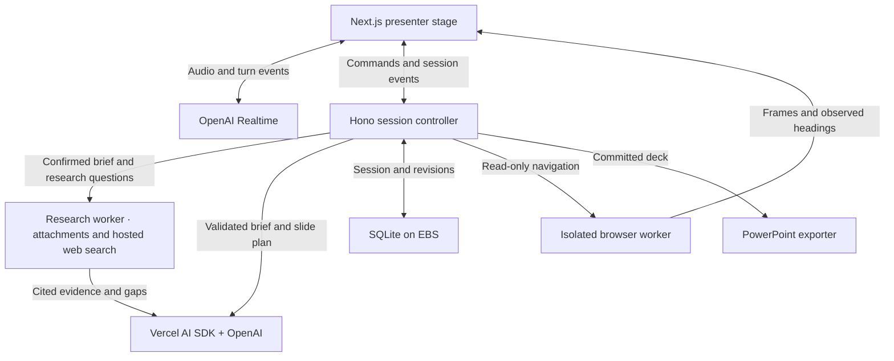

# Architecture · Voice-led presentation sessions

The implementation decision, protocol boundaries, simulation results and hardware acceptance criteria are in the [final voice architecture](voice-architecture.md).

## Fixed MVP architecture and ownership

The entry point is a private spoken interview. The research worker and deck compiler have lifecycles independent of the live voice socket. Keeping the interview responsive while those jobs run is a product requirement.

| Capability | Chosen runtime | Inputs and outputs |
|---|---|---|
| UI and room audio | Next.js/React in Chrome | Host starts audio with a gesture, supplies tracks and gets narration. Audience tab receives sanitized stage events only. |
| Voice | OpenAI Realtime WebRTC, Hono SDP broker and server-side control connection | One host mic and one output. Use one server response owner. Call standalone OpenAI Decisions on selected transcript partials. |
| Research | Bun worker using OpenAI Responses hosted web search | Confirmed brief plus approved public questions in; evidence and source URLs out. Record actual web-search invocation; a generated answer alone does not complete a research job. |
| Draft and command planning | Bun, Vercel AI SDK Core and Zod | Structured brief patches, source-grounded slides and validated commands. |
| Persistence and jobs | One EC2 deployment, SQLite on EBS | One transactional writer contract. Store project, source, job, evidence, revision, event and playback checkpoints. |
| Website tour | Separate restricted Chromium worker with Playwright | DOM observation, bounded action, verified visible frame. Raw page text cannot issue commands. |
| Export | Node PowerPoint generator | Pin committed revision and render from the same slide data that the audience saw. |

### Voice stack decision
Use one Realtime WebRTC adapter for private voice research and public delivery. The host controls playback and the server validates actions. The simulation results and protocol comparison are in the [voice architecture](voice-architecture.md).

LiveKit Agents for Node is the preferred alternative if individually connected remote speakers, per-participant tracks or room dispatch become P0. Its server-side participant, RPCs, turn detection and interruption metrics are useful; adopting it means adding a media room service and agent worker. Speaker identity from separate tracks still requires host permissions. Pipecat is the preferred alternative for a custom Python media pipeline, e.g. a local speech detector followed by interchangeable STT, decision and TTS processors. Its JS client can serve the same Next.js UX. Running that option adds a Python worker, matching transport and a cross-runtime event contract. Verify required language and provider support on recordings in either stack. Do not layer all three systems.

### Research worker contract
1. Save brief revision, research scope and accepted source IDs. Ask the planner for at most three questions whose answers would change the talk. Separate questions answerable from attachments from external information needs. Show questions in the host workspace.
2. Ingest each attachment independently; preserve PDF page, PPTX slide, CSV column/row range or URL/heading. Keep host claims attributed. If public lookup is enabled, form sanitized queries without confidential text and use hosted web search. Prefer primary evidence, preserve citation annotations, retrieval date and the actual supporting passage when available. Discard claims whose cited source cannot be traced.
3. Store evidence records with claim, source, locator, time period, units, evidence class and status (supported, conflicting, missing). For conflicting figures check definition, date and denominator. Show unresolved differences. Permit a narrower claim or omission. Never derive a chart from a search snippet alone.
4. Suggested budget: three questions, two lookups per question, 60 seconds total, one retry on a transient error. Keep a partial evidence bundle on timeout. If a material correction arrives, increment brief revision, cancel obsolete work where possible and reject late results at commit. Reuse unchanged evidence by source and question.
5. Compile a story spine (audience problem, evidence, requested action) before rendering. Require every externally checkable claim to reference a resolved evidence ID. Slides with unsupported claims return for one repair; omit the claim or expose a gap if repair fails. Record (briefRevision, evidenceRevision, deckRevision). Saving a new draft moves to review. Host must explicitly request presenting.

Separate public discovery from reading a named page. The default research provider is OpenAI Responses web search. Record its actual search, page-open or find action and the associated URL citations. A host-supplied URL alone is a request to inspect that page. Mark it unread if the provider cannot establish access. A future Gemini URL Context adapter can normalize retrieval status and source metadata into the same evidence contract. File-only mode omits both network tool paths. Keep private attachments out of public lookup queries. [OpenAI web search](https://developers.openai.com/api/docs/guides/tools-web-search) · [Gemini URL Context](https://ai.google.dev/gemini-api/docs/url-context)

### State machine and event ownership
Persist lifecycle (briefing, researching, drafting, review, live, finished), independently from stage surface (slide or browser), floor (agent, host or held) and operation (idle, loading, awaiting clarification or awaiting approval). Avoid a single enum that makes a paused browser tour indistinguishable from a paused slide. The Mode type below is a client display projection. Upload jobs can run in parallel with briefing. Only the controller changes lifecycle.

| Event | Guard | Effect / recovery |
|---|---|---|
| Build requested | Confirmed current brief, valid source scope | Enqueue uniquely keyed research job, then draft. Cancel returns to briefing. |
| User corrects brief mid-job | Changed material field | Mark old job superseded, keep valid sources, replan affected questions; audience sees nothing. |
| Present requested | Committed playable draft and active host | Bind audience display (or host fallback), initialize voice, set slide 1, await visual-ready then issue first narration. On timeout stay in review/paused with Retry or manual presentation. |
| Mic or display drops | Active session | Freeze advancement, persist cursor. Reconnect to a paused snapshot; ask host to resume. |
| Research request during Q&A | Current evidence insufficient | Offer live lookup with explicit scope. Hold slide, show progress privately, answer with source and let host choose whether to add it. |
| Late action / refresh / undo | Check turn generation and expected revision | Reject stale commits, deduplicate retries, restore last approved snapshot. |
| Finish while tool runs | Confirmed finish | Invalidate active generation, close voice/browser, enable export of committed revision. Export retries never reopen live mode. |

### Where Decisions belongs
In briefing it can suggest add-context, correct-brief or request-build. During research it can flag a material correction. During presentation it can tentatively detect yield. During a web tour it can suggest pause, redirect or return. Ship the yield trigger first. Use finalized utterances for other intents until early detection demonstrates value. No classifier owns evidence sufficiency, calculations, presentation start, deck commits, browser action authorization or successful playback. Those require validated inputs, a state transition or a measured event.

### AWS deployment topology
Public HTTPS domain → reverse proxy → Next.js and Hono on EC2. Next.js serves the UI and Hono authenticates the host, brokers provider sessions and streams non-audio events. Chrome sends audio directly to OpenAI. A supervised Bun jobs process polls SQLite for leased research/draft/export jobs, checkpoints completion and retries expired leases idempotently. Persist SQLite, uploads and exports on EBS. Run Chromium isolated from credentials, instance metadata and private destinations; expose it only to the controller. Restrict audience endpoints to projected content. Keep secrets server-side, enable restart-on-failure, and log project/turn/job/revision IDs with latency. AWS hosts the app and jobs; OpenAI hosts inference and web search. AgentCore Browser can replace the local browser boundary later. Configure a heartbeat/ready check for each external dependency and exercise a fresh session from the public hostname.

### Evidence for stack decisions
[LiveKit Node Agents](https://docs.livekit.io/reference/agents-js/) · [LiveKit interruptions](https://docs.livekit.io/agents/logic/turns/adaptive-interruption-handling/) · [Pipecat server framework](https://github.com/pipecat-ai/pipecat) · [Pipecat transports](https://docs.pipecat.ai/client/concepts/choosing-a-transport) · [OpenAI WebRTC](https://developers.openai.com/api/docs/guides/voice-webrtc) · [OpenAI hosted web search](https://developers.openai.com/api/docs/guides/tools-web-search?api-mode=responses)


## Implementation decisions for multilingual voice and live direction

Use the host's Chrome tab for audio, a read-only audience tab for projection, and one authoritative Hono controller on EC2. The audience tab acknowledges visible slide or frame IDs. The host tab supplies this acknowledgment in single-screen mode. The audience tab never opens the mic. Keep the distinction between audio turn, deck revision and visual surface explicit: a paused walkthrough still has a browser surface, and a voice answer can end without moving the deck.

### Speech onset, tentative intent and committed action

1. Give the host two controls: Talk (press to interrupt, hold for the command) and a hands-free toggle. Use hands-free in briefing and for a close host mic. Offer Talk for an open room. When hands-free is off, only transmit host-keyed input. Multiple people sharing a mic cannot establish speaker authority through a transcript.
2. In hands-free mode, duck local output on a credible speech onset and pin the cursor immediately. Keep mic capture active. Add browser echo cancellation; test through real speakers. Hold advancement during this provisional interruption. Use the provider's cancellation/clear mechanism on confirmed interruption or when its own VAD has already interrupted. Track whether the old audio was actually canceled. If canceled, restart the pinned sentence after a false alarm rather than unmuting a dead stream.
3. A provisional decision sees recent partial transcript, language hints, speaker channel, active transport, stage and prior sentence. Ask one closed question: “Is the speaker directing the presenter to yield now?” Choices: yield, keep listening, uncertain. A keyword alias can request a provisional pause immediately. Preserve negation, quotation, transliteration and later corrections for the final router. Include examples such as “stop,” “ruko,” “niruthu,” “don't stop,” “what does ruko mean?” and “ruko, enterprise only.” Treat coughs and blank transcripts as no command. A pure stop leaves the stage paused until continue.
4. Only final authorized turns may mutate state. In open-room mode preview edits and ask before opening a new origin. Content edits produce a private before/after proposal covering the visual, narration and source. Apply requires host consent against the displayed base revision. Keep original discards the proposal. Navigation remains immediate. In a compound request pause once, then route the edit for approval. For overlapping or unresolved speech hold the stage and ask for a repeat using Talk. Avoid repeated clarification on background noise. After a candidate turn with no evidence of intent resume the interrupted beat, unless the host explicitly paused.
5. Attach session ID, input turn, source event order, output response ID and epoch to callbacks. A newer interrupt fences off stale tool results, stale decision events and autoplay. A retry with the same command ID returns its existing commit. Invalidate a pending clarification if the host changes subject.

### Provider adapters and launch gate

Exercise one Realtime WebRTC connection with the event account and attach Hono on the server sideband. Test normal completion, barge-in, false-onset recovery and resumed speech. Use standalone OpenAI Decisions for provisional yield and the Vercel AI SDK for finalized commands. Missing Decisions access falls back to reversible onset holds and the final router. A missing paint or completion event holds the cursor for manual Next.

### Voice-guided website walkthrough

Keep a demo cursor with return slide, revision, goal, visited URLs, current observation ID, displayed frame ID, pending step and guidance mode. Support user-directed (“go to pricing”), guided autoplay (“walk us through the product”) and manual exploration (“let me drive”). In manual mode the agent only explains after an observed page change or an explicit request. For click-through manual control use AgentCore interactive view or validated click/scroll commands targeting the current frame. If the MVP only streams screenshots, offer host click-by-element and scrolling controls instead of claiming arbitrary remote mouse control.

For guided autoplay, inspect title, visible headings, accessible links and visible passage. Generate at most three steps with one visible target per step. Bind each step to an observed element ID and expected outcome. Re-resolve immediately before acting. Navigate or scroll, verify the new URL/heading is visible, capture the frame and wait for audience paint. Only then speak a short explanation tied to that observation. Advance after playback completes. If a locator disappears, re-observe and try once. If navigation is blocked or content unavailable, expose the observed condition and offer an alternative visible heading or Back. A host interrupt cancels the remaining tour; a late navigation may have physically completed, so re-observe before resuming. “Back and continue” restores the latest deck revision and restarts the pinned beat. For private spoken coaching require a distinct host audio output (headphones); on a single speaker setup show private cues as text.

Persist the agent role separately from lifecycle, visible surface and screen permissions. A host command can switch between presenter and audience on the same page. In presenter mode bind navigation tools to the visible frame and the host objective. In audience mode expose read-only observation, deck evidence and question generation. The human drives the cursor. Cancel outstanding narration/navigation on switch and re-observe any navigation that completed in flight. Keep role-play questions out of the deck until the host approves a specific edit.

### Validation budget

Percentages below are proposed gates, not observed results. Score by replay against expected actions and by live acoustic rehearsals. Compare keyword-only routing, final-turn routing, and standalone Decisions plus final routing on the same held-out examples. Count setup failures and timeouts. Report a separate hands-free and Talk result; no mixing silent rooms and noisy rooms without identifying the mix.

| Gate | Test and target |
|---|---|
| Multilingual stop | 20 positive trials per phrase across speakers, distance and noise. At least 19/20 per phrase must yield and remain paused. Measure p95 acoustic onset to audible stop; initial goal 350 ms on the host mic. |
| False interruption | 10 minutes each of silence, ambient speech and presenter echo. Target at most one false sustained pause per 10 minutes; record provisional dips separately. |
| Unsafe side effects | 30 negatives including quoted commands, negations, overlapping talk and late events. Target 0 unauthorized edits/opens. |
| Voice steering | 20 held-out compound commands; at least 18 execute all expected steps in order, with no extra action. |
| Guided website | 10 tours of supported public sites; at least 9 complete with visible target before narration and correct return cursor. Count arbitrary public URL trials separately. |
| Whole journey | 10 fresh sessions: briefing → generate → present → interrupt → edit → demo → resume → export. Target 9/10; record assistance and first failing module. Small samples describe rehearsal performance only. |

References: [OpenAI Decisions and voice](https://developers.openai.com/api/docs/guides/decisions-voice), [GPT-Live sessions](https://developers.openai.com/api/docs/guides/live-conversations), [Realtime playback events](https://developers.openai.com/api/reference/resources/realtime/server-events).


## Runtime and ownership

Next.js and the Bun/Hono API run on EC2. React owns microphone playback, visual rendering and presenter controls. A server-side session controller owns the brief, source references, deck versions, cursor and command authorization. OpenAI Realtime carries audio via WebRTC. Vercel AI SDK Core generates typed plans and routes finalized turns. SQLite on EBS stores session state. A Playwright worker controls an isolated Chromium browser. These are modules in one deployment. Use a persistent Bun process for the worker and live event stream.



## From microphone to presentation

1. POST /api/sessions creates a session plus host bearer token. A Start button unlocks audio playback and requests microphone permission. A Hono endpoint exchanges the SDP offer with OpenAI and returns the answer. Keep the provider key on the server. Open the Realtime event channel, enable transcription and phase-appropriate VAD, then disable automatic replies and automatic interruption. Use one response producer in the application. The remote audio track is attached once.
2. In briefing mode, accept finalized transcript or typed text through the same turn endpoint. Correlate transcription by item ID and ignore partials for commits. Keep transcripts ordered by recorded turn order even when final transcripts arrive late. Merge a structured brief patch with existing fields, preserve host corrections, and speak the next question. An attachment gets its own processing status.
3. Extract PDF text per page, PPTX text per slide, CSV via a typed parser, and website passages by heading. Retain source ID, location, excerpt and import timestamp. For image-only pages show an extraction limitation and accept pasted text. Cap input size, number of slides, rows and extracted characters. Keep one bounded evidence packet per generation request.
4. On host confirmation call generateText with Output.object and a Zod deck schema. Supply brief, source packet, allowed layouts and dataset schema. Validate every evidence pointer and chart column. Retry malformed or ungrounded fields once with precise errors. Save the complete revision atomically. Preview the first slide when ready. A failed regeneration keeps the last playable version.
5. Present by selecting a slide/beat, rendering its visual cue, acknowledging paint, then requesting narration. Repeat until interrupted or finished. See playback contract below.

## Minimal shared contracts

```ts
type Mode = 'briefing' | 'review' | 'presenting' | 'listening' | 'demo' | 'finished'
type Cursor = { slideId: string; beatId: string; revision: number }
type Anchor = { sourceId: string; location: string; excerpt: string }
type Beat = { id: string; targetBlockId: string; spokenText: string }
type Chart = {
  datasetId: string; groupBy: string; metric: 'conversionRate';
  segment?: string; latestMonths?: number
}
type Block =
  | { id: string; kind: 'text'; text: string }
  | { id: string; kind: 'chart'; query: Chart; points: {label: string; value: number | null}[] }
type Slide = { id: string; title: string; layout: 'title'|'evidence'|'chart';
  blocks: Block[]; beats: Beat[]; sources: Anchor[] }
type CommandContext = { sessionId: string; turnId: string; epoch: number;
  expectedRevision: number; commandId: string }
```

Use Zod discriminated unions for answer, clarify, editText, filterChart, openUrl, inspectSection, returnToDeck, resume, undo and finish. Only the controller executes tools. A compound “back and continue” becomes two ordered, validated commands. Prompt context includes the active surface, previous cursor, current slide, permitted dataset fields, latest user turn and evidence. A model never emits executable React, browser JavaScript, SQL or shell commands.

## Playback contract — what synchronizes voice and slides

Each beat references a block already on the slide. The stage uses a component registry for title, text and chart blocks. On beat selection, React mounts the slide, applies the highlight/reveal, waits for chart layout and paint, then emits visualReady(cursor, epoch). Disable chart entrance animation or wait for its completion. Only then issue response.create with the beat text and a request to speak it faithfully. Capture response ID and epoch. One beat is in flight. This is beat-level synchronization. Word-level alignment would require timestamped audio.

For WebRTC, response.done signals generation completion; output_audio_buffer.stopped signals the server-side output buffer drained. Advance only after successful completion, normal drain and the current host playback release for the active response. Client device playback may lag slightly; validate on event hardware. Cancellation, a cleared buffer or stale response cannot advance. A missing completion event times out to a visible Resume control. Never use estimated reading duration as a slide timer.

On speech_started, immediately mute remote playback locally, invalidate scheduled advances, increment epoch, cancel/clear outstanding output as appropriate to configured VAD and tell the server. Keep input live. Unmute for the next authorized response after old output is cleared. Route the finalized utterance against the pinned cursor. Save the interrupted beat; resume from its start, or regenerate it from the newest slide revision. During Q&A the response has purpose=answer, so its completion returns to listening. During demo a response has purpose=demo and cannot advance the deck.

## Applying edits, rendering and exporting

SQLite tables: sessions(id, mode, epoch, cursor, revision), sources(id, sessionId, status, location, payload), revisions(sessionId, number, deckJson), commands(sessionId, commandId, result), events(sessionId, sequence, type, payload). One transaction verifies epoch and expected revision, inserts the deck snapshot and command result, advances the revision, and appends an event. Unique command ID makes retries return the existing result. A newer interrupt invalidates pending work. A stale revision triggers reload and re-evaluation. Undo creates a fresh revision from the prior snapshot.

For filterChart validate segment and dates against parsed rows. Aggregate conversions/trials by month from raw totals. Missing denominators render as unavailable. Build chart points, an accurate takeaway and revised beats together. React renders from the committed JSON and signals paint. Export that exact revision with PptxGenJS, editable titles/body, chart image from the same points and source footers. Preserve the last successfully opened PPTX as an export test fixture. Later add template import as a renderer adapter: map actual PPTX placeholders to block IDs, capture slot geometry, preview overflow and patch the original package; preserve the existing session and playback contract.

## “Demo this URL” during a live session

1. Save return cursor and turn epoch. Resolve explicit typed/pasted URL, previously uploaded URL or clearly spoken host. If spelling is uncertain show the interpreted URL for confirmation or paste. “This URL” without a referent prompts once.
2. Start isolated browser context. Visit the approved public HTTPS origin, wait for DOM readiness with a timeout, return final URL, title, headings, visible text and first frame. Keep the slide visible until the frame arrives. Expose loading and Back immediately.
3. Hono streams bounded JPEG frames from the actual browser, e.g. 2 fps during a demo. The stage swaps its slide component for a frame viewport. A separate control path supplies DOM observations to the narrator. Narrate only observed content after its frame is displayed. On “show integrations,” match an observed heading, scroll it into view, refresh observation and frame, then explain. If absent, offer actual visible headings. Host can interrupt any explanation.
4. Browser worker accepts navigate, inspect, scrollToHeading and followPublicLink. Apply network egress restrictions to navigation, redirects and subresources; isolate from app secrets, EC2 metadata and private networks. Use an event-owned public site allowlist until arbitrary URL isolation is verified. Login gates, blocked pages and timeouts show the observed failure and offer return. Ignore instructions embedded on webpages.
5. On back, invalidate the browser action epoch, stop frame delivery, restore the pinned slide from the latest revision, wait for visualReady and resume only if requested. Stop the browser on finish or idle timeout.

EC2 Chromium is the shortest implementation. If the event account already has AgentCore Browser access, the same interface can connect Playwright to its managed session and use DCV Live View in place of JPEG frames. A general visual computer-use model is an optional adapter for unfamiliar screens. It adds latency and uncertain actions to the initial demo.

## API and recovery

| Endpoint | Contract |
|---|---|
| POST /api/sessions and GET /api/sessions/:id | Create or reload authorized snapshot, source status, cursor and revision. |
| POST /api/sessions/:id/voice | Accept SDP offer and return provider answer; short-lived session, no secrets in frontend. |
| POST /api/sessions/:id/sources | Multipart upload or URL, return source ID and status. |
| POST /api/sessions/:id/turns | Finalized input and command context; return answer, clarification, committed revision or async job ID. |
| POST /api/sessions/:id/control | Interrupt, visual-ready, playback-complete, present, resume or finish. Validate epoch and response association. |
| GET /api/sessions/:id/events | SSE with sequence IDs. Replay after Last-Event-ID, or send snapshot on gap. |
| GET /api/sessions/:id/browser/frame | Current JPEG with sequence, URL and epoch, no cache. Poll only while visible. |
| GET /api/sessions/:id/export?revision=N | Authorized download of committed revision N. |

On refresh reconnect to a paused snapshot, close obsolete audio sessions and request a new user gesture to resume. Log session, turn, epoch, response ID, slide, commit, frame and timestamps. Record speech onset, audible stop in rehearsal, final transcript, edit commit and first paint separately. Authentication, request limits, upload caps and cleanup are part of deployment. Use a single authenticated host for the demo.

## Technical references

[OpenAI WebRTC](https://developers.openai.com/api/docs/guides/voice-webrtc) · [Realtime events](https://developers.openai.com/api/reference/resources/realtime/server-events) · [AI SDK structured output](https://ai-sdk.dev/docs/ai-sdk-core/generating-structured-data) · [AgentCore Browser](https://docs.aws.amazon.com/bedrock-agentcore/latest/devguide/browser-quickstart-playwright.html) · [Live View](https://docs.aws.amazon.com/bedrock-agentcore/latest/devguide/browser-dcv-integration.html)

## Agent responsibilities and handoffs

These agents are logical roles in the TypeScript application. Each receives scoped context and permitted tools. The controller owns execution and persistent state.

| Role | Decision and tools | Persisted handoff |
|---|---|---|
| Research agent | Decompose the goal into questions, inspect supplied materials, search approved public sources, investigate gaps and stop at sufficient evidence or the research budget. | Evidence bundle, metrics, unresolved questions and suggested actions with provenance. |
| Presentation planning agent | Choose the story, visual units, narrative order, demonstrations and narration time. Request targeted follow-up research if an essential claim lacks support. | Versioned outline, derived slide count, duration estimate, rationale, optional cuts and stable IDs. |
| Decision agent | Interpret partial speech for reversible floor control; classify completed turns using current slide, agenda, permissions and pending clarification. | Typed proposed action or clarification, associated with turn and epoch. |
| Voice presenter | Interview the host, narrate the visible beat, answer from evidence and guide an observed website tour. Offer to compress the remaining talk if the host changes the time budget. | Playback checkpoints, answers and requested agenda changes. |
| Session controller and tools | Validate proposals; execute authorized search, chart computation, navigation, revision and export operations. | Durable agenda transitions, deck revisions and tool outcomes. |

**Planning algorithm.** Identify the decision the audience must make and the claims needed to support it. Assign each independently useful visual explanation a slide; group claims sharing a visual, and move supporting detail into notes. Reserve time for requested demos and questions. Estimate narration and transitions, then merge, split, cut or reorder until the proposed plan fits. If time is unspecified, select a reasonable pacing assumption and expose the estimate in preview. If constraints genuinely conflict, expose the specific tradeoff. Persist the rationale for the plan as a short host-facing explanation. Compile in batches as needed; validate evidence coverage, redundant slides and duration before review.

**Live replanning.** “We only have two minutes” targets the remaining agenda. Preserve completed history and the active cursor, prioritize the requested decision, shorten remaining beats and identify optional items to skip. Present the resulting change for approval when it materially rewrites the talk. A live cut changes the agenda; modifying the exported deck requires a deck edit.

## Research package · the boundary between preparation and live delivery

Research is the first independently runnable module. Input is a confirmed brief, source references, requested actions and presentation constraints. Output is one versioned bundle containing canonical structured JSON, its deterministic Markdown rendering, and an evidence index. Persist all three against the same bundle ID before marking ready. The Markdown is the human handoff; the live compiler reads the structured sibling so a renderer never has to infer a number or executable action from prose. Allow host edits through typed review controls, regenerate both representations, and pin the selected bundle on Go Live. Free-form Markdown round-trip editing is outside this release.

| Contract field | Required information and validation |
|---|---|
| Brief | Audience, desired decision, time budget, source policy, language, optional host-specified slide count, host constraints and unresolved questions. |
| Evidence | Stable ID, cited claim, origin (host/file/public), URL or file location, excerpt, as-of date if known, verification status. Missing or conflicting evidence remains visible. |
| Metric | Stable ID, dataset/evidence ID, time window, unit, numerator and denominator or explicit aggregation, group labels and raw values. Null represents unavailable. Store display rounding separately. |
| Findings | Narrative finding, implication for the audience, qualifications, evidence and metric IDs. The subsequent deck planner chooses highlights, visuals and narration. |
| Action proposal | Origin (host or research), objective, action type, placement relative to a slide ID, dependencies, evidence or URL, approval and fallback. |
| Handoff | Brief and bundle versions, unresolved gaps, source index and prose Markdown. Save slide count with the subsequent outline. Emit artifacts only after schema and referential validation. |

Example research memo excerpt using the demo CSV:

> Enterprise buyers converted at 20% (4 of 20 trials), compared with 10% overall (10 of 100, including enterprise). That difference supports investigating an enterprise pilot. This sample cannot explain why the groups differ. [Supplied January CSV, enterprise and SMB rows]

The compiler can use the two percentages in one visual. Its spoken beat explains the group overlap, sample size and implication in language suited to the buyer. Q&A can retrieve the raw counts independently. Demo roles, consent and switch behavior are defined in [the product contract](product.md#interruption-consent-and-walkthrough-roles).

Layout selection is a registry lookup: title, evidence or chart. Count only slide items. When the host supplies a count, honor it or surface a concrete conflict. Otherwise derive the count from the completed outline. No default, product cap or fixed-length array belongs in the prompt, schema or UI. Generate long decks in batches against the same approved outline. Estimate speaking time from script length and a configurable speaking rate, then add tour time. On overflow shorten notes or propose combining slides in preview. Keep the original metric and source IDs when layouts change. A future template adapter maps named slots and bounds to these same blocks; incompatible slots require a host-visible fallback.

## Persistent agenda and scheduling

Persist agenda_items(id, sessionId, kind, targetId, origin, placement, orderKey, dependsOn, approval, status, reason, updatedSequence). Kinds: presentSlide, demoUrl, lookup, followUp. Store the full ordered agenda independent of deck order. Research-suggested actions start proposed; host approval of the preview activates included proposals. Explicit host directions enter the plan with origin=host. A source document cannot authorize its own action. Record host acceptance separately from execution status.

| Transition | Trigger and semantics |
|---|---|
| pending → active | Scheduler picks the first approved eligible item in agenda order after checking dependencies. Exactly one foreground item owns the stage. |
| active → done | Final narration beat completes normally or host explicitly finishes the demonstration. Starting playback is insufficient. |
| active → parked | Host opens a detour. Save return item, beat and surface. MVP supports one parked foreground item; redirect subsequent tour commands within the current tour. |
| pending/active/parked → skipped | Host names an item or says skip against the current cursor. Cancel its playback and pending tools; record reason and advance. |
| active → blocked | URL unavailable, dependency missing or action times out. Offer retry, skip or return. Do not silently fulfill dependent actions. |
| parked → active | Back restores a still-eligible item against the latest revision. If removed or skipped, pick the next eligible item. |
| skipped/done → active | Only explicit revisit, with a fresh execution attempt ID. History retains the original outcome. |

When a parent slide is skipped, skip its attached optional tour by default. An independently host-requested tour with its own objective stays pending; show its placement and let the host skip it too. If the skipped slide was a hard dependency, block the child instead. Validate dependency cycles before saving. “Next” during a slide marks remaining beats skipped and advances; “pause” holds the item; “finish” cancels outstanding work and freezes the run. Keep skipped items out of automatic scheduling across reconnects.

Every mutating request carries commandId, expected agenda sequence and deck revision. In one transaction apply status changes, persist cursor, increment sequence and emit event. Use a separate ephemeral generation number to fence outstanding audio, search, render and browser operations. Example race: host skips slide 2 while its chart is being calculated. Reject the superseded result before commit, reject the old playback event at the scheduler, start slide 3 once. If the chart already committed before Skip, its revision stays saved and Skip affects only the agenda. Export reads deck revision; a session recap reads agenda history.

## Context window and evidence retrieval

The database owns memory. Reconstruct each model call from the committed state. Four distinct records cover the raw transcript, confirmed host preferences, verified evidence/deck revisions, and agenda/cursor. A conversation summary speeds retrieval. It cannot overwrite an explicit instruction, claim authority or mark a task done.

| Call | Always include | Retrieve only when relevant |
|---|---|---|
| Research planner | Confirmed brief, source policy, requested actions, unresolved questions and time limit | Short excerpts matching each research question |
| Deck compiler | Approved outline, allowed layouts/count, evidence and metric IDs for each slide | Supporting passages for that slide; compile individually if the full bundle exceeds budget |
| Narrator | Active item, slide revision, current beat, visible target and output language | Current slide evidence and pronunciation hints |
| Q&A / command router | Final user turn, surface, cursor, permissions, last clarification and action status | Active slide evidence first, then other project evidence by entity and keyword. Return source IDs or explicitly flag insufficient support. |
| Website guide | Tour goal, actual origin, current observation/frame ID, visible targets, visited steps and return cursor | The last relevant host direction and matching source anchor |

Suggested initial live input budget: 6,000 tokens, capped further by the selected model limit after reserving output and tool overhead. Allocate up to 1,000 for policy and state, 1,200 for current slide or page, 2,200 for up to four evidence excerpts, 800 for recent dialogue and 800 for agenda and brief summary. Count serialized tokens before dispatch. Drop old conversation and low-ranked evidence first; retain authority, current command, slide revision, unresolved clarification and active/parked actions. For a long agenda, send current item, next two and counts; expose a narrow lookup for a named skipped or pending item. Never truncate a metric midway or detach an excerpt from its source. If essential data cannot fit, split the request or ask for scope.

At every finalized turn persist transcript and state changes separately. Compact old turns at a threshold (initially eight turns or 75% of budget), recording covered sequence numbers. Rehydrate a new voice session with brief, cursor, authorized current beat, language and recent correction on disconnect or provider context exhaustion. Audio reconnect starts paused. Use an explicit update after an edit so old voice-session context cannot narrate a superseded number. On “what did we skip?” query the agenda table; on “why did conversion drop?” retrieve evidence. A queue status is exact stored data, while an explanation requires evidence.

## End-to-end integration tests

1. Research a new topic, produce presentation.md, verify references and preserve a blocked question. Reopen tomorrow with no transcript and generate the same approved slide order.
2. Host specifies five slides plus a URL tour. Verify exactly five slide plans and a separate tour action. Change to three before approval and verify stable IDs for retained slides.
3. Skip mid-sentence, deliver an old playback-complete event, refresh, then continue. Verify the skipped slide stays skipped and the next item starts once.
4. Plan one URL in research, introduce another during Q&A, then go back. Verify their origin, ordering, status and return position.
5. Exhaust the input budget with long documents and dialogue. Verify current metric, host restriction and skipped actions survive compaction; stale data never changes an export.
