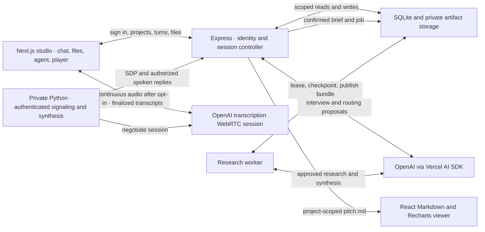
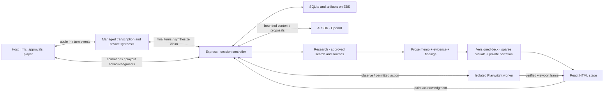

# Architecture · Interview, research and interruptible HTML presentation

The product has two independently useful outputs. First, the host receives a ready-to-speak pitch, source references and a supporting research memo. Second, the presenter delivers a reviewed HTML deck, can yield mid-sentence, and can explain which point to cover when the host says “continue.” The durable session connects them. A fresh browser should be able to present an approved deck from its saved revision.

Implementation status and outstanding acceptance tests are tracked in the [current gap register](continuation-review.md#current-gap-register).

## Module 1 SaaS architecture

Module 1 delivers a private pitch studio. A customer signs in, opens a project, briefs the agent, approves research and receives a cited pitch they can reopen or download. Live delivery and guided walkthroughs extend that saved project in Modules 2 and 3. The diagram shows the Module 1 release target. [Module 1 acceptance contract](../handoffs/1-pitch-studio.contract.md)

| Customer action | Release contract |
|---|---|
| Sign in and open a project | Express resolves the account and its private workspace. List and create projects there. Each session belongs to a project. Check project access on every session, source, job, file and voice connection. A fresh browser resolves the project after sign-in and restores the saved transcript, attachments, job status and artifact versions. Sign-out ends access and audio capture. |
| Speak, attach files and review scope | Chat, attached files and generated files occupy the center of the desktop studio. The agent, microphone status and stop control sit on the right. React plays replies on one host player. The browser streams microphone audio to OpenAI over WebRTC. The private Python adapter negotiates the transcription session. Express accepts a finalized turn once for the current session and resolves the host's intent. Language changes and interruptions keep the same conversation open. |
| Approve research and keep talking | Confirm the precise brief revision and permitted source scope. A leased job checkpoints its work independently of the browser and voice connection. A question about progress reads that job. A revised scope creates a new brief revision and fences stale results. Reopening the project recovers the active job or its committed outcome. |
| Select the finished file | The successful job commits evidence, the pitch, its chart and the supporting memo together. The conversation shows a selectable `pitch.md` bound to the completed research ID. Selecting it opens that saved version in a private artifact viewer with Preview, Markdown and Download. `presentation.md` is the supporting research memo. Each later research run has its own file identity. |

**Worker authority.** Derive workspace and project identity from the authenticated account. Carry those identifiers, the session and confirmed brief revision on the job lease and resulting artifact records. Scope every lookup by workspace and project. A worker can claim approved jobs, read their permitted sources and commit results against its current lease. A lost lease or superseded brief invalidates that commit. A scoped machine credential authorizes the worker. The customer's login credential stays at the HTTP boundary.

**Chart contract.** The synthesis model proposes a chart type and evidence candidate IDs. The backend checks the selection, comparable units and source values before embedding `{name, description, type, data}` in a fenced `recharts` block. Module 1 supports bar and line charts. Each point has a label, numeric value or null, unit and evidence ID. Rates may carry a numerator and denominator. The private viewer validates the payload, renders Recharts and offers the source table. Invalid data leaves the rest of the pitch readable. [Chart service](../backend/src/services/pitch-chart.ts) · [Viewer](../frontend/components/research/PitchDocument.tsx)

**Current implementation.** Accounts own projects in SQLite. A signed-in host can reopen a saved pitch in a fresh browser, with the agent on the right and files in the conversation. The studio negotiates continuous transcription through Express and Python. Hosted, provider and physical-room evidence are tracked in the [acceptance handoff](../handoffs/1-pitch-studio.md). [Host session](../frontend/lib/research.ts) · [Studio](../frontend/components/research/ResearchWorkspace.tsx) · [Voice adapter](../voice/server.py)

**Release evidence.** Walk two accounts through the hosted service. Confirm that each can reopen its own project from a clean browser and that cross-account reads, writes and media connections are denied. Interrupt a spoken status reply during research, restart a worker, then open the resulting pitch and verify its chart against the cited source. Rehearse with real microphones and the selected provider in the supported languages. Exercise provider failure, retry, backup restoration and operator-visible job failures. Record the environment and observed results before calling the module released.

The [AWS operations guide](aws-operations.md) covers image digests, gateway routing, request and job latency queries, and restoring the project volume.

## Stack and trust boundaries

| Component | Selected implementation | Authority |
|---|---|---|
| Host and audience | Next.js, React, TypeScript, Tailwind, shadcn/ui and TanStack Query. HTML/CSS slide templates and a host-owned player. | Host can approve a revision. Audience can acknowledge its assigned frame or slide. Only the host plays room audio. |
| Session controller | Express on Bun, Zod, SQLite on EBS, sequenced events and immutable deck revisions | Validates commands, manages the floor and agenda, records attempts and publishes public projections. Bun matches the existing SQLite implementation. |
| Text intelligence | OpenAI via Vercel AI SDK. Purpose-scoped model configurations, structured proposals, a stronger synthesis model when justified. | Proposes questions, findings, edits or target IDs from the permitted context. The controller owns execution. |
| Voice target | OpenAI WebRTC transcription with private Python signaling and synthesis, React-owned playout | The browser receives transcript segments. Python returns approved synthesized audio. React reports application playout and cutoff. |
| Browser target | Isolated Chromium/Playwright worker, bounded read-only actions and approved origins | Reports observations and captures frames. The audience device acknowledges display. |
| AWS | ECS on EC2 behind Caddy HTTPS, encrypted EBS data, private worker services, Secrets Manager and CloudWatch. | Keep keys and private evidence on the server, authenticate workers and issue narrowly scoped audience access. |

### HTTP ownership

Express 5 owns the public HTTP boundary on Bun. Feature routers mount at `/api` and `/api/sessions`. Controllers validate inputs and translate service outcomes into JSON, Markdown, audio or server-sent events. SQLite repositories and leased jobs are independent of Express request lifetimes. The Python interview worker receives short-lived request data on the private network. Only the Express application receives host bearer credentials. Contract tests open a real local HTTP listener and send the same requests as the frontend.

## 1. Interview and research

1. Start privately. Spoken and typed input enter the same brief. Keep host words, inferred assumptions, private attachments, approved URLs and proposed public queries distinct. Learn the audience, requested decision, time, language, source scope and requested demonstrations as relevant. A precise prompt can go directly to review. For “pitch onboarding,” ask the one question most likely to change the search, such as whether the listener is a buyer choosing a pilot or an engineer choosing an integration.
2. Show the interpreted brief and public questions. A host answer patches the brief. Build confirms its exact version. Keep the foreground turn path available during research. “How far did you get?” reads job progress. “Only my files” narrows scope, invalidates dependent results and prevents new outbound searches. Keep one durable job key per session and confirmed brief. Renew leases and check the current revision before every dispatch and commit.
3. Ingest material with a locator. For pasted material retain its character range. Target PDF pages, PPTX slide numbers and CSV row ranges as additional adapters. In files-only mode omit external lookup tools. For discovery, use hosted web search with reviewed public questions. For an explicit page, require a completed open/find action on that URL and a matching citation. Retrieval failure leaves a gap and offers pasted material. Private material must never be appended to a public search query.
4. Store findings with evidence IDs and supporting excerpts, origin, retrieval location and gaps. Compare units, population, time period and denominator before combining metrics. Compute charts from source rows. An excerpt match proves traceability; a separate review must evaluate whether it supports the claim. Conflicting sources retain both definitions. The existing research implementation bounds public lookup tasks and withholds unsupported reference/excerpt pairs.
5. Save the memo and speaking content together. The synthesis response includes an opening, supporting points and a closing ask. The review also checks each speaking passage before the host receives it. The private pitch endpoint reads the saved script or existing reviewed findings without another model call. A second pass compiles the talk. Preserve the distinction between a visible assertion, private explanatory narration and support available for Q&A. A deterministic first compiler can select short highlights from validated findings without another paid call. Pitch variants ask the configured planning model to select and order approved slide IDs for the audience and speaking time. Without a usable model response the service ranks existing slides by audience terms and keeps complete explanations within the budget. Review shows the rationale and a duration estimate at 135 words per minute plus three seconds per slide. Walkthrough time is a later addition.
6. Private review is the handoff. Preview the actual HTML, clarify omissions, request a diff, approve the revision and start explicitly. Hold spoken updates while the host is speaking. Keep a cleanup path for expired audio and unapplied proposals.

## 2. Presentation and intervention

| Moment | Immediate behavior | Durable effect |
|---|---|---|
| Start | Select an approved revision, create a host playback generation, render the first visual and obtain paint confirmation. Authorize one speech attempt with specific claim, text, asset and revision. | Save cursor and attempt. Public content is a projection. Private narration and transcripts stay with the host. |
| Host begins speaking | Duck or stop locally, pin the visible target and hold advancement. Capture continues. Talk provides an explicit ownership signal in a noisy room. | Record cutoff and whether playback was partial, complete or uncertain. Silence or a partial transcript cannot commit an edit. |
| Final turn arrives | Resolve a pending choice first, then interpret referents against the pinned slide, metric, filter, page or parked agenda item. Use one small-model proposal for natural language; explicit UI commands bypass inference. | Check host authority, expected revisions, generation and idempotency. A stale “yes” cannot approve a different proposal. |
| “Why did that number change?” | Retrieve the current and previous populations. Explain that four of twenty enterprise trials is 20%, while ten of one hundred overall is 10%. Cite the source and acknowledge unknown causes. | A completed answer returns to listening. Its playback never marks the interrupted slide complete. |
| “Actually fix that” | Ask what “that” refers to when ambiguous. For a specific correction show a private before/after of the affected visible highlight and narration. Keep the previous revision playable. | Approve once against the base revision, invalidate changed audio, repaint, then resume. Reject keeps the prior revision. Retain completed credit only for unchanged claims. |
| Continue, back, skip or reconnect | Consult point requirements, delivered claims, verified demo objectives, explicit skips and current dependencies. | Resume the earliest unfinished eligible point. Replay a partial claim at a safe sentence boundary. Reconnect paused; an explicit revisit gets a new attempt. |

A point in the plan declares what satisfies it. Setup may be satisfied by **either** an explanation **or** a displayed demo. A mandatory limitation may require **both**. If setup is displayed after a mid-sentence interruption, the demo can complete the point while the spoken attempt stays partial. If the site requires login, the explanation remains due. The next sentence follows the plan's requirement and the recorded observations. This is the continuation harness. [Paired fixture and independent scoring](continuation-review.md)

## 3. Guided walkthrough · from utterance to webpage

For “show setup, but only if it doesn't need a login,” the router proposes a goal (“setup”), condition (“public access”), origin reference and return cursor. Resolve “this site” using the approved tour, the last host URL or a clarification. Browser execution has four distinct steps:

1. **Observe.** The worker returns the final origin, page title, named headings, links and controls, visibility and a fresh observation ID. Assign ephemeral target IDs to the observed candidates. Provide only a bounded relevant subset to the router. Treat page text as evidence, with no command authority.
2. **Resolve.** Exact accessible name and role win when unique. “Setup” may also refer to “Getting started” or “Quickstart.” For a semantic match, give the small model the goal, allowed actions and candidate IDs. It must select one of those IDs or ask, for example, “Account setup or SDK installation?” Resolve again if the DOM changes. Model-generated selectors, scripts and arbitrary URLs never enter the executor. [Playwright locators](https://playwright.dev/docs/locators)
3. **Act and verify.** During partial speech allow one expiring private prefetch to a known read-only destination. Final authorization permits one bounded navigation or scroll. Recheck origin, redirects, login condition, target text and meaningful visibility including overlay occlusion. Capture the same viewport as a frame tied to the observation. Timeout, changed target and login are explicit outcomes. “Actually skip it” fences the attempt and prevents its frame from reaching the stage.
4. **Project and continue.** Attach run, attempt, revision, epoch, observation and frame identity. Wait for the designated audience stage to decode and paint that frame, then allow narration of the observed content. A late frame after Back earns zero objective credit. In agent-as-presenter mode the agent may perform authorized navigation. In agent-as-audience mode the human drives; expose read-only observation and questions. Changing role cancels queued speech/actions and preserves the parked slide.

## 4. HTML quality is a release gate

HTML is the presentation deliverable. The deck schema holds slide IDs, layout, headline, short visible highlights, evidence references and private narration. React maps these fields to semantic markup with a small template registry. Author content as text; the model has no path to inject scripts, CSS or page-sized generated HTML. Choose layouts by information shape. A comparison needs comparable values and units, a claim needs one takeaway and support, and a conclusion needs a decision. Avoid copying the memo into slides. A long claim belongs in notes or on another slide.

The host preview, live stage and offline HTML should agree on revision, visual hierarchy and visible claims. Test actual browser rendering at a projector size, desktop and narrow phone. Require visible title and highlights, no horizontal clipping or colliding source/footer, readable type, working keyboard or link navigation, distinct states without color alone, and an offline file without network calls, secrets or private notes. Preserve approved words when resolving overflow through splitting, layout changes or private review. Capture representative screenshots and rehearse on the actual projector before declaring room readability. Native PPTX is outside the HTML release gate.

## 5. How the harness lowers cost

The harness is ordinary application code around model calls: contract validation, scoped context, permission checks, deterministic tools, a revision ledger, playback observations, browser proof and replay tests. A model can choose the intended operation; it cannot determine from its own text that the audience screen painted or that audio completed.

| Work | Cheapest suitable path | Escalation rule |
|---|---|---|
| Pause, next, resume, duplicate commands, math, status, HTML rendering | Local code and indexed state. Zero LLM calls. | Missing data becomes a gap or clarification. |
| Interview patch and final-turn routing | Small structured-output model, current state plus a few named candidates, bounded output. Start an evaluation with an account-supported mini model. | Repair an invalid proposal once. Ask the host on unresolved authority or ambiguous reference. |
| Public research and synthesis | Limit lookups per approved question, reuse unchanged evidence and completed bundles, use a model that actually supports the selected hosted tool. | Use a stronger model on a difficult evidence conflict or story-planning task only if the result can change the approved talk. |
| Live speech and demos | Synthesize short approved beats once; key assets by normalized text, language, voice and synthesis config. Synthesize new answers and changed beats on demand. Use visible DOM candidates before screenshots; keep at most one speculative fetch per turn. | Escalate a difficult grounded answer once, with a deadline and a logged reason. After timeout offer clarification, retry or a qualified answer. |

Order models by purpose and capability. Transport retry and semantic escalation are separate decisions. Log model ID, versioned rates, uncached/cached tokens, search calls, STT audio duration, TTS billable units, wasted preparation and EC2 allocation by run. Report preparation cost separately from the cost per successful live interaction. For illustration, at published GPT-5.4 mini text rates of $0.75/M uncached input and $4.50/M output, a 900-input/100-output-token routing call is about **$0.001125** before tools, voice and infrastructure. Twenty such calls cost about $0.0225 for routing alone. Measure total usage and latency on the actual account before changing defaults. [Model specifications and pricing](https://developers.openai.com/api/docs/models/gpt-5.4-mini)

## 6. What demonstrates the moat

Freeze the expected action, forbidden side effects, spoken status, demo status and next claim for 16 held-out traces across two speakers. Compare a well-prompted frontier baseline, a cheap model with the same simple loop, and the cheap model with controlled context and the ledger. Give each equal access to the underlying observations, evidence and tools. Repeat with speculative fetch on/off. The primary score requires both the right action and the right continuation. Also record false coverage, missed/false holds, public echo-only holds, acoustic stop latency, speech-end-to-paint, escalation and total cost per success. An HTTP fixture proves ordering; an actual laptop and audience device are required for acoustic and display claims.

Use the [voice protocol](voice-architecture.md), [12-hour release gates](plan.md) and [agent handoffs](orchestration.md) for implementation. Production AWS readiness requires an externally reachable hostname, working TLS and media, scoped credentials, real provider calls and a fresh-device rehearsal.
