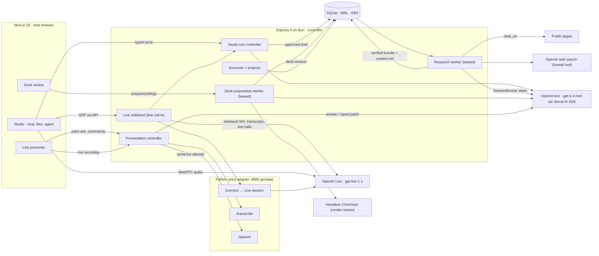

# Audit 4 · System design as built (2026-11-21)

This is the source of truth for what the code does today. Where a doc disagrees, this file is right; see Audit 1 for the list.

## 1. One picture

## 2. Components and the authority each one holds

| Component | Owns | Never does |
|---|---|---|
| Browser | Mic capture, audio playout, local stop on barge-in, paint acknowledgement | Choose actions, send tool results, see provider keys |
| Live model (`gpt-live-1.1`) | Hearing, speaking, turn-taking, proposing `propose_research` / `start_research` | Commit anything; its tool calls are only proposals |
| Express controller | Every durable change: brief revisions, consent (proposed + heard + start), jobs, deck revisions, cursor, edit approvals | Trust model text as authority |
| Research worker | Tool loop within budget, evidence capture, verification, publication fenced by its lease | Exceed approved scope; publish unverified claims |
| Deck worker | Planning from the verified bundle, ≤3 render passes | Use transcript or instruction text as slide content |
| Python adapter | Provider calls that need audio (Live SDP, STT, TTS) | Hold state; it is stateless and private, authenticated by `VOICE_WORKER_TOKEN` |

## 3. Key flows

**A. Spoken brief → plan → consent → job**
1. Browser offer → `/api/.../live/connect` → Python `/connect` pins the model, voice and data-channel permissions → `session_id` → Express opens the sideband.
2. The sideband receives `input_transcript.delta` and `output_transcript.delta` with `start_ms`/`end_ms`. `live-interviewer.ts` groups each exchange, discards backchannels, and records verbatim with `voice_items: ["live:<start_ms>"]`. A typed turn calls `flush()` first, so order is preserved.
3. The model calls `propose_research{subject, audience, outcome, deliverable, summary, queries ≤3, urls ≤8}`. Zod validates it, URLs normalise through `site_url`, and the controller saves the proposal.
4. Consent requires three things: (i) the plan is proposed, (ii) the next host input starts at or after `spoken_until` (heard), and (iii) a `start_research` call or the button. Only then does the controller enqueue **one** job per brief revision. It closes voice after the acknowledgement.

**B. Research job.** Lease → `collect_research` (SessionRunner: web_search / read_url, 10 per pass, an optional second pass for a named gap) → writer → `quotes()` excerpt check → independent checker → `keep_supported` → publish the bundle (findings, evidence `P*/H*/M*`, charts, `context.md`), or `needs_input`.

**C. Deck.** Prepare(ceiling) → 202 + job → planner (verified bundle only) → number/evidence review → Chromium render of the shared templates → repair ≤3 passes → draft revision → host approves.

**D. Live.**
1. Approve → controller state `awaiting_paint` → browser paint acknowledgement → `narrating`.
2. Each sentence is spoken with its `attempt_id` through `/speech`.
3. A mic onset stops the player locally and pins `{revision, slide, sentence}`.
4. The recording goes through `/transcribe`, then a live-turn model call, which returns a cited answer, a clarification or a typed patch.
5. A patch waits for Apply or Reject. Apply commits the revision once, then the controller waits for the paint acknowledgement and speaks the added sentence before advancing.

## 4. Data (SQLite, one writer)

| Area | Tables |
|---|---|
| Identity | `studio_accounts`, `studio_logins`, `studio_projects` |
| Conversation | `studio_turns`, `studio_context`, `studio_updates`, `studio_question_playout` |
| Research | `research_briefs`, `research_jobs`, `research_activity`, `research_sources`, `research_bundles`, `research_progress_turns` |
| Deck | `decks`, `deck_revisions`, `deck_preparations`, `deck_proposals`, `deck_turns` |
| Live | `live_presentations`, `live_presentation_commands`, `live_presentation_turns`, `live_presentation_model_attempts` |
| Legacy, unused by the UI | `audience_tokens`, `audience_stages`, `continuation_*`, `ai_sessions/runs/events` (the `/chat` path) |

## 5. Failure handling (designed and tested)

| Failure | Behaviour | Test |
|---|---|---|
| Browser closes during research | The job continues and the result appears on reopen | `check-pitch-studio.ts` (worker restart) |
| Worker crashes | Lease expiry → reclaim → resume from the checkpoint with no repeated lookups | `studio-research.test.ts` |
| Duplicate approval or two tabs | One job; a stale proposal returns 409 | `studio-turn.test.ts` |
| Stale playback callback | Ignored by `attempt_id` | `presentation-live.test.ts` |
| Mic denied | Typed path for the whole flow | Fixture AC-8 |
| Evidence insufficient | `needs_input`, no artifact | AC-13 |
| Live voice idle | Closes after 120 s; 15 min maximum life; at most 4 calls | `live-call.ts` |

## 6. Known structural risks

1. **One SQLite writer, one host.** Fine for a demo and a single-tenant pilot; horizontal scale needs Postgres or a single-writer service. This is documented in `presentation-flow.md`.
2. **Two voice stacks.** Live for the interview, a cascade for presenting. That is defensible (presenting needs approved-text playback and sentence attempts, which Live doesn't expose), but it must be explained, or it looks accidental.
3. **The model configuration has one entry and no `purposes`.** `gpt-5.4-mini` serves interview delegation, research, planning and live. There is no escalation path yet.
4. **Dead surface.** The audience routes, the `/chat` legacy path, the `continuation_*` tables and the `voice/.venv` Pipecat leftovers. Remove them or document them.
5. **JavaScript-rendered sites** return thin text without Playwright. Research quality on SPAs is bounded until browser reading lands.
