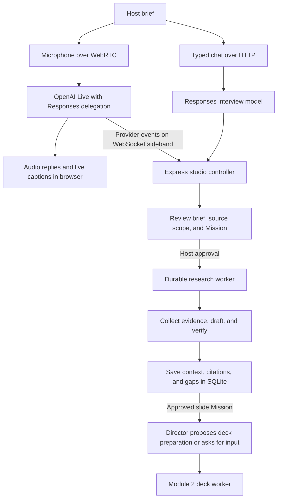
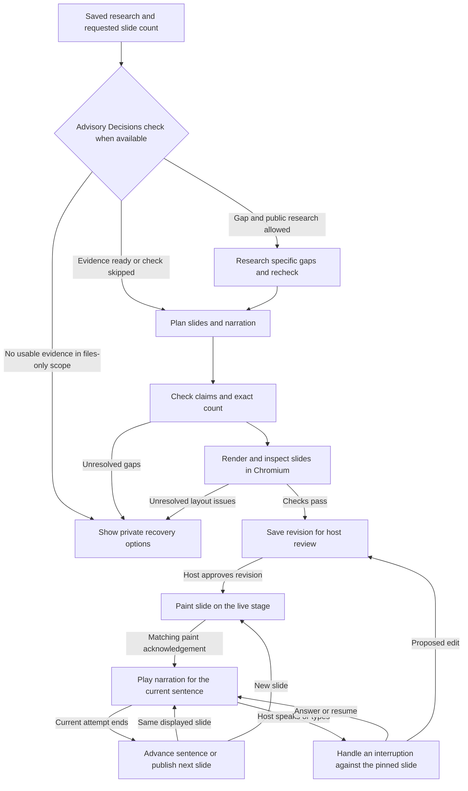
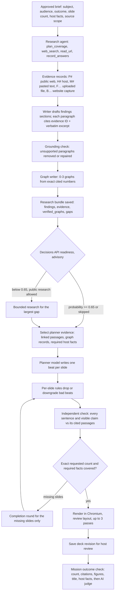
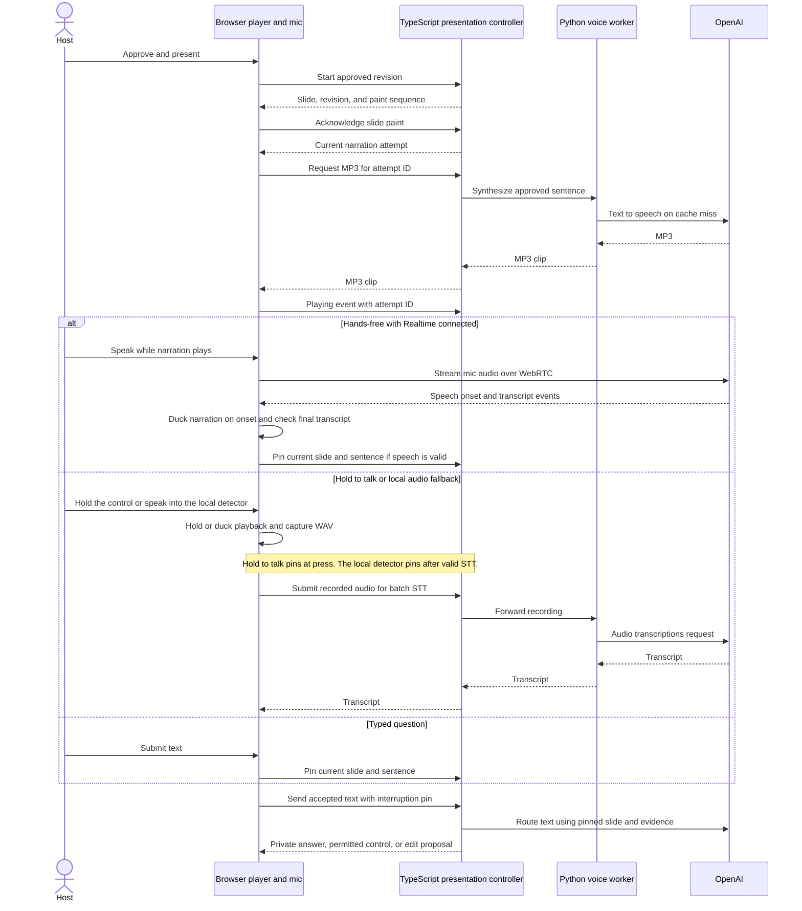
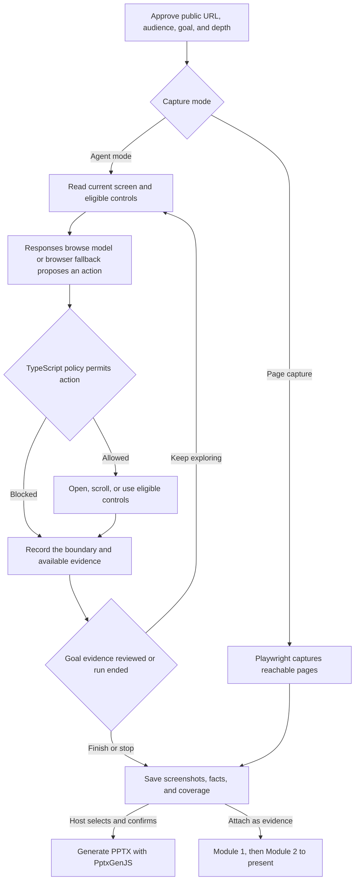

# copitch module architecture

The three modules share a Next.js frontend, an Express API running on Bun, and SQLite. TypeScript controllers own approvals, job dispatch, and revision changes. Models propose actions or produce content. The Python voice worker is a Starlette and HTTPX adapter to OpenAI. **Pipecat is absent from the current stack.** Voice coordination lives in the browser hooks, TypeScript controllers, and the OpenAI connection.

Model names below are **repository defaults**. `OPENAI_TEXT_MODELS` can replace the text model list by purpose. The Live model, speech-to-text (STT) model, text-to-speech (TTS) model, and voice are configurable separately. [Text model configuration](../backend/src/services/model-config.ts) · [Voice worker](../voice/server.py) · [Compose defaults](../docker-compose.yml)

| User action | Audio flow |
| --- | --- |
| Speak to the **studio interviewer** | **Realtime speech-to-speech.** Microphone → OpenAI Live over WebRTC → streamed spoken reply and captions. A delegated Responses model proposes app actions. |
| Listen to **slide narration** | **TTS.** Approved sentence → speech synthesis → MP3 → browser player. |
| Interrupt the stage **hands-free** | **Realtime STT**, with a batch fallback. Mic → transcript → live Responses model → private answer, control, or edit proposal. Eligible spoken answers use a separate TTS request. |
| Interrupt the stage with **Hold to talk** | **Batch STT.** Mic → WAV on release → transcript → the same live Responses path. |
| Type a question **on stage** | **Text.** Typed text enters the live Responses path directly. |
| Ask the **website agent** to capture a site | **Browser automation.** Playwright and Responses act on page observations. The narrated stage becomes available through Module 2 once the captures are part of an approved deck. |

## Transports

Both WebRTC and a WebSocket are used, for different jobs.

| Transport | Between | Used for |
| --- | --- | --- |
| **WebRTC** (audio plus a data channel) | Browser ↔ OpenAI | Studio voice call ([use-voice-agent](../frontend/hooks/research/use-voice-agent.ts)). Hands-free listening during a presentation ([presentation-realtime](../frontend/lib/presentation-realtime.ts), [room microphone](../frontend/hooks/deck/use-room-microphone.ts)). |
| **WebSocket** (server side) | Express ↔ OpenAI Live | **Only the studio voice call.** Express attaches to the same Live session to save finalized turns, run validated actions and pass Mission card edits as quiet context. [Interview sideband](../backend/src/controllers/live-call.ts) |
| **HTTP** | Browser ↔ Express | Typed chat, commands, uploads, narration MP3s, batch speech-to-text, live turns. |
| **SSE** | Express → browser | Project change notices and the streamed research brief. |
| **Polling** | Browser → Express | Live presentation state every **650 ms**. Mission every **1.4 s** while working. Website run every **1.1 s** while running. |

Presentation hands-free has **no server WebSocket**. The browser receives transcript events on its WebRTC data channel, then sends the accepted text to Express over HTTP.

### Studio voice call: one session, two connections

> **WebRTC carries voice. The WebSocket carries tool calls.** The host's audio goes straight to OpenAI for speed. Express listens in and acts only after checking the model's request.

OpenAI creates **one** Live session per call. The browser joins it for audio. Express attaches to the **same session** by its ID (`/v1/live/sessions/{id}/attach`). The model runs once and the call is billed once.

```
                         ┌──────────────────────┐
                         │      OpenAI Live      │
                         │  (hears you, talks)   │
                         └──────────────────────┘
                     ▲          ▲            │
         voice both  │          │ transcript │ tool calls:
         ways (fast) │          │ text +     │ "save plan?"
                     │          │ events     │ "start research?"
              WebRTC │       WebSocket  (control only, no audio)
                     │          │            ▼
            ┌────────┴───┐   ┌──┴──────────────────────────┐
            │    Host    │   │          Express API          │
            │ (browser,  │   │  checks: approved after the   │
            │   mic)     │   │  readback? words really said? │
            └────────────┘   │  current revision? in budget? │
                  │          │  → saves turn / applies action│
                  │  HTTP    │  → returns the tool result    │
                  └─────────►│  (only to start the call)     │
                             └───────────────────────────────┘
```

One spoken approval, end to end:

```
Host speaks ──WebRTC──► OpenAI hears "yes"
OpenAI ──WebSocket──► Express: start_research tool call
Express checks: full plan read out + approval spoken after it ✓
Express starts research ──WebSocket──► OpenAI: "started"
OpenAI ──WebRTC──► Host hears "Starting the research now"
```

| Connection | Carries | Why |
| --- | --- | --- |
| **WebRTC** | Host and agent audio, captions | Low latency. Absorbs packet loss and jitter. Browser echo cancellation. No audio load or bandwidth on our server |
| **WebSocket** | Transcript text, tool calls, tool results, Mission card updates | The browser can't fake an approval. The API key stays on the server. Turns are saved server-side. Express can add context mid-call |
| **HTTP** | Call setup (SDP offer → answer) | Express authorizes the project before the call starts |

| Rejected alternative | Problem |
| --- | --- |
| Browser only (tools run in the browser) | Approvals could be faked, and the API key would be exposed |
| Server only (audio relayed through Express) | Extra delay on every word, worse audio, more server load and code |

| Cost of this design | Effect |
| --- | --- |
| Two views of one call can drift | A tool call can reach Express before the host's words are transcribed. This is the cause of the dropped spoken plan change, fixed in `289e920` |
| WebRTC needs UDP | Some venue Wi-Fi blocks it, and the studio voice call fails. Typed chat and the presentation's Hold to talk use HTTP and still work |

The presentation needs neither a realtime voice model nor a WebSocket:

```
Host holds Space ──HTTP──► Express ──► speech-to-text ──► gpt-5.4-mini ──► answer
Express ──HTTP──► Host: slide + narration MP3 (TTS), one sentence at a time
```

## Module 1 · Interview, research, and Mission

**Input** is a brief spoken by the host or typed into a private project. **Output** is saved research with evidence IDs, citations, and gaps. An approved slide Mission can continue into Module 2.



| Stage | Stack and default model | Role |
| --- | --- | --- |
| Typed interview | OpenAI Responses through Vercel AI SDK, `interview` purpose → `gpt-5.4-mini` | Turns the request into conversation, clarifying questions, and structured plan proposals. |
| Spoken interview | Browser WebRTC and OpenAI Live `gpt-live-1.1`, voice `marin` | Handles the conversational audio and emits input and output caption deltas. This path uses Live's integrated speech processing. |
| Spoken action proposals | OpenAI Live delegates to the Responses `interview` model → `gpt-5.4-mini` | Proposes structured actions from speech. Express receives them on its WebSocket sideband and checks the current project and approval before applying any action. |
| Research | OpenAI Responses, `research` purpose → `gpt-5.4-mini` | Collects evidence, drafts and verifies findings, and can use hosted `web_search` and a controlled page reader within the approved scope. A files-only brief stays within supplied material. |
| Mission orchestration | OpenAI Responses, priced `director` purpose → `gpt-5.6-luna` | Proposes the next bounded step and checks whether the final deck fulfills the goal. The TypeScript worker owns job dispatch, spending checks, and the saved Mission state. |

The browser opens voice after the host explicitly enables the microphone. It sends an SDP offer through Express and the Python worker, then exchanges media directly with OpenAI over WebRTC. Caption deltas reach the browser through the data channel. Express attaches separately to the same call and saves finalized turns and validated actions. When spoken approval starts research, the agent finishes its acknowledgement and closes capture. The research worker continues independently.

Project change notifications use **SSE**, which prompts the browser to refresh saved resources. The research context preview uses a separate SSE response to stream saved Markdown. The Mission panel polls its working state in addition to refreshes triggered by studio events.

**Decisions API.** Interview delegation and the Mission Director use Responses with structured output. The separate `/decisions` evidence check belongs to Module 2.

Code. [Studio agent](../backend/src/services/studio-agent.ts) · [Live session setup](../backend/src/services/live-session.ts) · [Interview sideband](../backend/src/controllers/live-call.ts) · [Research provider](../backend/src/services/research-provider.ts) · [Mission controller](../backend/src/services/director.ts) · [Mission worker](../backend/src/workers/mission.ts)

## Module 2 · Deck generation and live presentation

**Input** is saved research, a requested slide count, and the approved audience and goal. **Output** is a cited deck with private narration, a live stage, and an offline HTML export.



| Stage | Stack and default model | Role |
| --- | --- | --- |
| Readiness | OpenAI Decisions API `POST /v1/decisions`, pinned in source to `gpt-6-luna` | Receives requested count, approved intent, findings, gaps, and selected passages. Returns an evidence sufficiency probability and the largest gap category. |
| Supplemental research | Responses `research` → `gpt-5.4-mini` | Looks for evidence for the identified gap when the approved source scope allows public research. |
| Planning, grounding, and layout review | Responses `planning` → `gpt-5.4-mini`, plus actual Chromium rendering | Proposes slides and narration, independently checks factual support, and checks the rendered slide layout. |
| Live question and edit routing | Responses `live` → `gpt-5.4-mini` | Interprets the finalized text against the pinned slide and evidence. The controller handles a cited answer, a permitted navigation command, clarification, or a private edit proposal. |
| Speech-to-text | `gpt-4o-mini-transcribe` | Hands-free uses an OpenAI Realtime transcription session. Hold to talk and the hands-free fallback upload a recorded WAV for batch transcription. |
| Text-to-speech | `gpt-4o-mini-tts` with voice `marin` | Synthesizes approved narration sentences and eligible spoken answers as MP3 clips. The voice worker caches clips by text. When the browser requests one sentence, the API starts generating the next two, so they are usually cached before they are needed. The browser plays narration at **1.2×** with pitch preserved (`NARRATION_RATE` in the narration player). The TTS model ignored pace instructions in a measured comparison. |

The Decisions check is advisory. A probability below `0.65` can trigger bounded gap research if public lookup is approved. A metered Mission skips this call when its price is unverified. If the advisory endpoint is unavailable, the planner and independent checks still run. The requested slide count remains separate from the number of research sections. The host can recover verified partial work privately when the available evidence cannot support the complete deck.

### From research to slides



**Research → bundle**

| Step | Input | Output | Rule |
| --- | --- | --- | --- |
| Coverage plan | Brief | 3–6 (focused) or 6–10 (broad) checklist questions | Questions name measure, unit, period, entity |
| Search and read | Checklist | Evidence records `P#` | Only approved sources. Files-only skips the web |
| Record answers | Read passages | Answer + verbatim excerpt + evidence ID per item | States facts, never deck advice |
| Draft | Answers, evidence | Findings sections; each paragraph has `support[]` (evidence ID + excerpt) | The excerpt must appear verbatim in the record |
| Grounding | Draft | Verified findings + gaps | Unsupported paragraphs removed or repaired |
| Graphs | Cited numeric records | `verified_graphs`, at most 3, 2–12 points each | Same unit and period. Exact reported values only. No forecasts |
| Host facts | Host messages | `H#` evidence, brief `studio_notes` | Copied word for word |
| Attached sources | Files, pasted text, website captures | `F…` (file), `M#` (pasted, 1,800-character chunks), `B…` (website steps) | Material is background for research. Cited like any other record |

**Decisions API (readiness check, advisory)**

| Field | Value |
| --- | --- |
| Endpoint and model | `POST /v1/decisions`, `gpt-6-luna` |
| Inputs | Requested slide count, approved intent, findings, gaps, selected passages |
| Outputs | `enough_evidence` probability; `largest_gap` ∈ `scope`, `breadth`, `measurements`, `context` |
| Ready when | probability ≥ **0.65** |
| Not ready, public allowed | One bounded research round for that gap, then plan |
| Not ready, files only | Plan anyway, or offer private recovery |
| Skipped | Endpoint unavailable, or an unpriced metered Mission. Planning still runs |

**Planner input (what the slide model sees)**

| Field | Source |
| --- | --- |
| `slide_count` | Host's requested count. Independent of the number of research sections |
| `findings`, `headings` | Grounded research sections |
| `evidence` | Passages linked by findings or graphs, plus required host facts. Budget about 68 KB |
| `available_graphs` | `verified_graphs` |
| `context_assessment` | Deck title, objective, audience, known gaps |
| `objective_findings` | Required host facts (always enforced) and objective items the model must cover |

**One beat → one slide**

| Beat field | Becomes on the slide |
| --- | --- |
| `title` (≤ 72 characters) | Slide title |
| `highlights` (≤ 4 × 110 characters) | Bullets |
| `template` | Layout: `title_card`, `bullet_slide`, `metric_grid` (≤ 4), `timeline` (2–4), `quote`, `comparison` (2 columns), `bar_chart` / `line_chart` / `donut_chart` (2–12 points), or a saved research graph |
| `evidence_ids` | Slide citations and source footer |
| `sentences[]` (1–8, each with evidence IDs) | Private narration, spoken one sentence per audio clip |

**Per-slide rules (a failing slide is dropped or downgraded; the rest of the deck survives)**

| Trace code | Rule |
| --- | --- |
| `draft_instruction_or_missing_spoken_content` | No placeholder text. At least one spoken sentence |
| `duplicate_title`, `duplicate_takeaway` | Each slide says something new |
| `uncited_evidence` | Every cited ID exists in the planner evidence |
| `unsupported_number_on_slide` | Every visible number appears in a cited passage |
| `unsupported_number_spoken` | Every spoken number appears in that sentence's cited passages |
| `unknown_or_reused_graph` | A graph slide uses a saved graph once |
| `template_downgraded:<type>` | A chart, metric or quote lacking quoted support becomes a bullet slide |
| `empty_text_slide` | A bullet slide needs bullets |

**Deck-level checks**

| Check | Outcome on failure |
| --- | --- |
| Independent verification of each slide's claims | The slide is dropped; unverified narration is trimmed (`trimmed_unverified_narration`) |
| Exact requested count | Completion round for the missing slides only. If still short: `insufficient_evidence` and private recovery with the verified slides |
| Required host facts covered (`objective_findings`) | Repair round, then a gap shown to the host |
| Chromium render review | Layout repair, at most 3 passes. Then `render_review_failed` names the slides |
| Mission outcome check | Count, citations, figures, title = subject, host facts with an `H#` citation. Then the AI judge reviews audience and purpose. Gaps → **Needs you** |

### How the presenter coordinates slides, narration, and the host mic



1. **Slide and playback ownership.** The controller persists the approved deck revision, current slide and sentence, playback generation, stage sequence, and attempt ID. It waits for the matching paint acknowledgement before scheduling narration on a newly displayed slide. Chrome plays the clip and reports when playback starts, ends, or fails. Stale callbacks cannot advance a newer revision or attempt.
2. **Hands-free.** Chrome opens the microphone and feeds an AudioWorklet with mic audio and the narration reference when available. A separate microphone track goes to OpenAI over WebRTC for Realtime STT. The provider's voice activity detection reports when speech starts and stops. The browser ducks narration on onset, then checks the final transcript for meaningful speech and rejects narration echo or a stale slide anchor before pinning the slide. Without Realtime, the local audio gate can use the mic and playback reference to capture a WAV for batch STT. A connection loss can discard the current take and ask the host to repeat.
3. **Hold to talk.** Holding the on-screen button or keyboard control immediately holds playback and requests an interruption pin. Releasing the control sends the WAV to Express and the Python worker for batch STT. A valid transcript goes to the live-turn controller using that same pin. On a failed transcription, the UI offers retry or typing and can restore the interrupted playback state.
4. **Typed questions and slide edits.** Typed and spoken text share the same live-turn controller and slide context. A question can produce a private answer. A correction can produce a proposed slide change, which the host approves separately. The controller verifies approval against the proposal and base revision before publishing the updated slide.

The browser polls live state every 650 ms while the stage is active. The player sends commands and paint acknowledgements over HTTP. On the deployed site, Hold to talk transcribed all three recorded attempts. In fullscreen, Space taps pause or resume and a held Space records, even while focus is on the fullscreen control. A statement from the presenter (as opposed to a question) is accepted as host evidence and acknowledged. A question still needs research support. Physical microphone and speaker interruption for hands-free remains unverified.

Code. [Deck preparation worker](../backend/src/workers/deck-preparation.ts) · [Decisions adapter](../backend/src/services/presentation-readiness.ts) · [Live controller](../backend/src/controllers/presentation-live.ts) · [Presentation repository](../backend/src/repositories/presentation-live.ts) · [Narration player](../frontend/hooks/deck/use-narration.ts) · [Hands-free capture](../frontend/hooks/deck/use-room-microphone.ts) · [Hold to talk](../frontend/hooks/deck/use-hold-to-talk.ts)

## Module 3 · Website walkthrough and PowerPoint

**Input** is a host-approved public URL, audience, goal, and crawl depth. **Output** is saved website evidence and a native PowerPoint from the host's confirmed selection. The host can also attach the capture and generate a narrated deck through Modules 1 and 2.



| Stage | Stack and default model | Role |
| --- | --- | --- |
| Page capture | Playwright and Chromium | Captures pages and records screenshots, visible facts, and failed attempts within the approved link depth. |
| Agent mode | Playwright and OpenAI Responses, priced `browse` purpose → `gpt-5.6-luna` | Proposes a browser action from the current observation. The TypeScript runner checks scope, validates the action, and controls the browser. A browser-only fallback is available. |
| Goal coverage | Separate structured Responses call to the browse model | Checks whether saved steps support the approved goal when the model proposes finishing. The application can also save a partial result. |
| Confirmed PowerPoint | PptxGenJS, TypeScript, SQLite | Renders the selected text, links, and screenshot bytes plus explicit host additions. The export uses the confirmed selection directly. |

**Decisions API and voice.** Module 3 checks coverage through Responses. It opens and scrolls the public site during the capture run. When attached to a deck, the saved captures become slide content and Module 2 provides narration and host microphone controls.

Code. [Agent runner and coverage review](../backend/src/services/site-agent.ts) · [Browser policy](../backend/src/services/site-policy.ts) · [Page capture worker](../backend/src/workers/website-walkthrough.ts) · [PowerPoint selection and export](../backend/src/services/walkthrough-selection.ts)

## Voice, slide, and microphone coordination

Only the studio voice call uses realtime speech-to-speech. The presentation combines speech-to-text, a text model and text-to-speech, with the TypeScript controller coordinating each step.

| Flow | Audio type | Models (defaults) |
| --- | --- | --- |
| Studio voice call | **Realtime speech-to-speech** | OpenAI Live `gpt-live-1.1` (voice `marin`) delegates decisions to Responses `gpt-5.4-mini` |
| Slide narration | **TTS**, one sentence per clip | `gpt-4o-mini-tts`, voice `marin` |
| Hands-free interruption | **Realtime STT**, with a local batch fallback | `gpt-4o-mini-transcribe` (streamed; server voice activity detection) |
| Hold to talk | **Batch STT** on release | `gpt-4o-mini-transcribe` |
| Reply to an interruption | **Text**, then **TTS** for eligible spoken answers | Responses `live` → `gpt-5.4-mini`, then `gpt-4o-mini-tts` |
| Website agent | No audio | Responses `browse` → `gpt-5.6-luna`, Playwright |

### Flow A · Studio voice call (realtime)

1. The host enables the mic. The browser sends an SDP offer through Express and the voice worker, then opens **WebRTC** to OpenAI Live.
2. Live hears and speaks directly. Input and output captions arrive on the WebRTC data channel.
3. For an app action (`propose_research`, `start_research`, `prepare_slides`, `revise_slide`, `mission_command`), Live delegates to the Responses model, which returns a tool call.
4. Express is attached to the same Live session over a **WebSocket**. The [interviewer](../backend/src/services/live-interviewer.ts) checks each tool call before the [studio controller](../backend/src/services/studio-turn.ts) applies it:
   - **Start research** counts only if the host's approval was spoken after the full plan readback ended.
   - **Plan changes and slide commands** must come from host words that ended before the tool call, on the current Mission revision. If the agent speaks a lead-in before calling the tool, the words already heard are used.
5. Express returns the outcome (`function_call_output`, then `response.create`). Live paraphrases it to the host. The outcome either confirms the action or says that nothing was saved.
6. Each finalized exchange is saved as a studio turn. When the host edits the Mission card during the call, Express sends the current plan as quiet context (`session.thinking.append`).

### Flow B · Presentation narration loop (TTS)

The [presentation controller](../backend/src/services/presentation-live.ts) owns slide, sentence and playback state. The browser shows and plays only what the controller schedules.

1. The controller publishes the slide. The audience stage reports the paint (`POST /audience/paint`) with the matching stage sequence and revision. Narration starts only after that acknowledgement.
2. For each sentence, the controller creates a **playback attempt** with a new attempt ID. The browser fetches that attempt's MP3 (`GET /live/audio/:attempt`). The API also starts generating the next two sentences, which the voice worker caches by text.
3. The [narration player](../frontend/hooks/deck/use-narration.ts) plays the clip at 1.2× and reports `playing`, then `ended` (`POST /live/commands`). The controller advances to the next sentence, or publishes the next slide and returns to step 1.
4. Every callback carries the attempt ID and revision. The controller rejects callbacks from an older attempt or revision.

### Flow C · Interrupting the presentation

| Entry | What happens |
| --- | --- |
| **Hold to talk** (hold Space, press B, or hold the button) | Narration holds immediately and the slide and sentence are **pinned** at press. The AudioWorklet records the mic. On release, the WAV goes to batch STT (`POST /interview/transcribe`, about 1 s). Esc cancels. In fullscreen, a tap of Space pauses or resumes, and a hold records. |
| **Hands-free** | The mic streams to a realtime transcription session over WebRTC. On speech onset, narration ducks to 20% volume. On the final transcript, text that matches the current narration sentence is treated as echo: it is discarded and the volume restored. Otherwise the slide and sentence are pinned. If WebRTC is unavailable, the in-browser [room gate](../frontend/lib/room-utterance.ts) compares the mic with the narration reference, captures the speech and uses batch STT. |
| **Typed** | The host submits text in the private panel. The current slide and sentence are pinned. |

The accepted text goes to the [live-turn router](../backend/src/services/live-turn.ts) (`POST /live/turns`, about 1.6 s) with the pinned slide, its evidence and the last two exchanges. The model returns one outcome, which the controller checks:

| Outcome | Rule |
| --- | --- |
| **Answer** | Must quote research evidence. A presenter's statement (not a question) may cite the host's own words. Numbers must appear in the cited excerpts, and an independent check verifies the wording. The answer is shown privately and can be spoken with TTS. |
| **Clarify** | One question to the host. Playback stays paused. |
| **Edit** | A proposed change to the pinned slide. The audience sees it only after the host approves it, against the same base revision. |
| **Control** | Next, back, pause, resume or go to a slide. Approve and reject must use the review buttons. |
| **Ignore** | Noise, backchannels and short acknowledgements. |

The pin is released when the turn finishes. If narration was playing before the interruption, it continues from the pinned sentence after a spoken answer or an ignored turn. A pending edit holds playback until the host decides. A clarification leaves playback paused until the host resumes.

### Harness

**Runtime harness**

- Durable workers run research, deck preparation, the Mission and website runs. They checkpoint to SQLite and resume after a restart.
- Models only propose. The controller validates approval, revision, citations and scope before it changes state.
- Every Mission model call is priced and reserved against the budget before dispatch.
- All requests and jobs are traced to the host's persistent journal.

**Verification harness**

| Check | Covers | Status (2026-11-22) |
| --- | --- | --- |
| Backend and frontend unit tests | Controllers, state machines, guards, the narration and Mission flows | 269 backend and 23 frontend tests pass |
| [Audio regression](../frontend/lib/room-utterance.audio.test.ts) and [echo simulator](../simulations/voice/rca/sim.ts) | Hands-free onset detection and echo rejection, with recorded speech | Pass. No physical device involved |
| [Chrome rehearsal](../simulations/presentation/chrome-acceptance.mts), [live voice probe](../simulations/voice/live-voice-probe.ts) | Studio → deck → stage, with recorded audio fed as the mic | Available. Not rerun on 2026-11-22 |
| Deployed trace logs | Real timings and failures | Running since 2026-11-22. See the next section |
| Physical mic and speakers in a room | Hands-free interruption | **Not yet tested** |

## Measured on the deployed site

Source: API trace logs on the EC2 host (`journalctl CONTAINER_NAME=app-api-1`), about one hour of real use on 2026-11-22. Samples are small. Use them as a baseline, not as service levels. Server time excludes the network between the browser and us-west-2.

| Module | Step | Requests | Server time |
| --- | --- | --- | --- |
| 1 | Voice call connect (`POST /interview/connect`) | 2 | 0.3–0.9 s |
| 1 | Voice actions on the sideband | 5 received, 3 applied | One spoken plan change was dropped as `command_unmatched` (fixed in `289e920`) |
| 1 | Research job | 2 | 53.6 s each |
| 1 | Mission polling (`GET /mission`) | 157 | 1–2 ms |
| 2 | Deck preparation | 2 completed, 1 failed | 23.4 s completed, 37.1 s failed |
| 2 | Live state polling (`GET /live`) | 1,985 | about 1 ms |
| 2 | Paint acknowledgement (`POST /audience/paint`) | 333 | 5 ms median |
| 2 | Playback commands (`POST /live/commands`) | 141 | 5 ms median |
| 2 | Narration clip (`GET /live/audio/:attempt`) | 64 | **5 ms median** (pre-generated), 1.5 s p95, 2.0 s max |
| 2 | Hold to talk STT (`POST /interview/transcribe`) | 3 | 1.0 s median, 1.6 s max |
| 2 | Live question or statement (`POST /live/turns`) | 3 | 1.6 s median, 2.5 s max |
| 3 | Start a website run | 1 | 21 ms |
| 3 | Website run | earlier runs | 20–60 s, $0.01–0.02, 5–7 screens |
| 3 | Run polling and screenshots | 25 + 29 | 1–2 ms |

An interruption takes about 2.5–3 s from release to answer: speech-to-text plus the live model. The live state poll is the busiest traffic, at about 2,000 requests per hour per open stage.

## Orchestration and verification harness

**Runtime harness.** Express starts the TypeScript research, deck, Mission, and website workers. SQLite stores the current revision, approved scope, durable job state, and checkpoints. The controller validates each proposed action before updating state. In live presentation, that same pattern binds render acknowledgements, audio attempts, and microphone turns to the current slide and revision. [Worker startup](../backend/src/index.ts) · [Session store](../backend/src/repositories/session.ts) · [Presentation state machine](../backend/src/services/presentation-live.ts)

| Harness | What it observes |
| --- | --- |
| Studio voice in Chrome | The live voice probe and Realtime smoke script feed a recorded WAV into Chrome's microphone stream against a configured preview. They observe live captions, saved turns, and whether a proposal or research job appeared. The smoke script can exercise a language switch. [Voice probe](../simulations/voice/live-voice-probe.ts) · [Realtime smoke](../simulations/voice/realtime-smoke.ts) |
| Deck and presentation in Chrome | The presentation rehearsal follows the studio, deck, stage, playback, and saved state. It can feed a recorded question. The API-side live smoke script exercises stage paint, audio, and state against the configured voice worker. [Chrome rehearsal](../simulations/presentation/chrome-acceptance.mts) · [Live API smoke](../simulations/presentation/live-smoke.ts) |
| Acoustic echo replay | The local simulator feeds recorded speech and a speaker reference through the same room detector used by the browser. It measures speech onset and tests echo conditions without requiring the provider. [Echo simulator](../simulations/voice/rca/sim.ts) · [Audio regression](../frontend/lib/room-utterance.audio.test.ts) |
| Website runner | The website fixture drives Chromium against controlled pages with synthetic decisions and verifies depth, screenshots, blocked actions, and checkpoint behavior. The separate live Chrome walkthrough exercised a public crawl and the saved PowerPoint download. [Website runner checks](../backend/tests/site-agent.test.ts) |

The browser replay exercises the live integration with recorded input. The acoustic simulator isolates signal handling. A physical-device rehearsal measures the actual room and device path.
