# From research context to an interruptible presentation

## Current release goal

The studio checks whether the saved evidence supports the exact requested slide count and fills the shared HTML templates. Playwright renders and checks the deck. The planner can revise a failed layout and rerender it, with three whole-deck passes total. Present on the host's screen with echo-aware speech interruption and private approval of slide edits.

The deck is the deliverable. Research findings, source links, and graph data stay in the project for planning and citations. Validate in Chrome against real providers, then check echo and double-talk with a physical microphone and speakers. The running preview is outside this change.

## The host flow

1. Approve the research scope in chat. The worker saves an account-scoped research revision with verified findings, evidence IDs, and supported charts.
2. Select a slide count from 1–12. OpenAI Decisions assesses evidence for the requested count and the approved goal. If the coverage is thin, the worker can run one targeted follow-up within the approved public source scope and then reassesses readiness. Files-only projects use the saved materials. Preparation saves an exact-count reviewed deck or reports what the host can retry or add.
3. Review the slide sequence, private narration, and sources. **Approve and present** approves the displayed revision and starts delivery on this screen. The browser can ask for microphone permission at this point.
4. Once the microphone is available, speak over the agent to ask a question or request a change. The browser compares capture with recent speaker audio to reject echo. The host can type if the room is noisy or the microphone is unavailable. A proposed slide change stays private until the host accepts it.
5. Exit live view to return to review, or download the public HTML deck.

## Architecture

```mermaid
flowchart LR
    Chat["Host chat and attachments"] --> Brief["Approved research brief"]
    Brief --> Worker["Leased research worker"]
    Worker --> Research[("Saved research revision<br/>findings · evidence · verified chart blocks")]
    Research --> Ready{"OpenAI Decisions readiness"}
    Ready -->|first gap with approved public search| Followup["Targeted source research"]
    Followup --> Ready
    Ready -->|unresolved evidence gap| Chat
    Ready -->|sufficient evidence| Planner["Deck planner<br/>research ID + exact slide count"]
    Planner --> Check["Schema and evidence review"]
    Check --> Render["Playwright<br/>shared HTML templates · whole deck"]
    Render --> Judge{"Browser metrics and screenshot review"}
    Judge -->|layout repair, up to 3 deck passes total| Planner
    Judge -->|pass| Deck[("Private deck revision<br/>slides · narration sentences · citations")]
    Judge -->|limit reached| Chat
    Deck --> Review["Host review and approval"]
    Review --> Stage["Host-screen slide projection"]
    Review --> Live["Express live controller<br/>revision · cursor · attempt"]
    Stage -->|matching paint and heartbeat| Live
    Live -->|approved sentence| Voice["Private Python speech adapter"]
    Voice -->|audio for current attempt| Player["Browser player"]
    Player -->|recent speaker reference| Mic["Browser microphone and echo-aware speech onset"]
    Mic -->|stop audio locally| Player
    Mic -->|pin slide and sentence| Live
    Mic -->|final utterance| Live
    Live -->|transcribe recording| Voice
    Voice -->|transcript| Live
    Live -->|cited answer or private proposed edit| Review
    Deck --> Export["Standalone public HTML"]
```



| Boundary | What crosses it |
|---|---|
| Research → planner | The account-scoped research ID, bounded verified findings and linked evidence, and checked numerical series. Message history, raw transcript, and model instructions are separate from presentation content. |
| Planner → render review | Grounded slides with stable IDs, checked against the shared HTML templates. Playwright measures clipping, overlap, and legibility. The configured OpenAI planner model can inspect a contact sheet. Repairs receive slide-specific feedback and must pass evidence review again. |
| Review → live | The explicitly approved deck revision and a scoped stage generation. A matching paint acknowledgement unlocks playout. |
| Live → renderer | The signed-in presenter sees the approved slide on the current screen. The microphone and narration controls belong to the host. |
| Live → speech | An approved narration sentence or an independently grounded answer. Attempt ID and revision fence old audio after an interruption. |

The planner reuses verified chart series. Slide review, live display, and offline HTML use the same templates so labels, units, and values stay consistent. A chart requires comparable points and sources. A narrative slide can stand on its own with concise points.

| Component | Entry point |
|---|---|
| Research and graph extraction | `backend/src/services/research-agent.ts`, `backend/src/services/research-graphs.ts` |
| Queue, plan, and store a deck | `backend/src/controllers/deck.ts`, `backend/src/workers/deck-preparation.ts`, `backend/src/services/presentation-planner.ts`, `backend/src/repositories/deck.ts` |
| Browser review and bounded repairs | `backend/src/services/deck-render-review.ts`, `backend/src/services/deck-render.ts`, `frontend/components/deck/DeckRenderCheck.tsx` |
| Review, stage, and HTML export | `frontend/components/deck/DeckWorkspace.tsx`, `frontend/components/deck/LiveDeck.tsx`, `frontend/components/deck/Slide.tsx`, `frontend/lib/export-deck.ts` |
| Capture, playback, and command state | `frontend/hooks/deck/use-room-microphone.ts`, `frontend/hooks/deck/use-narration.ts`, `backend/src/controllers/presentation-live.ts`, `backend/src/repositories/presentation-live.ts` |

## Interruption sequence

```mermaid
sequenceDiagram
    participant H as Host browser
    participant S as Express controller
    participant V as Private speech adapter
    H->>S: Approve revision and start
    H->>S: Acknowledge first slide paint
    S->>V: Synthesize approved sentence
    V-->>H: Audio for current attempt
    Note over H: Speech onset stops playout locally
    H->>S: Pin interrupted attempt and sentence
    H->>S: Submit completed utterance
    S->>V: Transcribe recording
    V-->>S: Final transcript
    alt Grounded question
        S-->>H: Cited answer, then resume pinned sentence
    else Slide correction
        S-->>H: Private diff; current slide remains approved
        H->>S: Apply exact proposal against its base revision
        H->>S: Acknowledge revised slide paint
        S-->>H: Play accepted narration, then advance
    else Noise or unclear request
        S-->>H: Resume safely or ask for clarification
    end
```

## Limits and checks

- React owns microphone capture, immediate audio stop, and observed playback. Express owns revisions, the speech cursor, command authorization, and advancement. Python converts speech and text. Research and deck preparation use durable job leases.
- Decks are saved snapshots. Generate a new deck to apply these planning rules to older research. An older context with little evidence may need a fresh research run to support more slides or charts.
- The existing deployment uses an Express runtime with SQLite on one host. A horizontal rollout needs a shared or single-writer store, coordinated presentation state, and shared media or generation-aware routing. SQLite coordinates preparation leases in the current single-store deployment.
- The render worker reuses one headless Chromium process and limits concurrent browser contexts. Each deck review receives only slide fields, blocks external resource requests, and discards the browser context and screenshot after the check. Set `DECK_RENDER_ORIGIN` to the trusted internal web origin and `DECK_RENDER_CHROMIUM` to the container's browser executable when deploying.
- The prepare request queues a durable job and returns its ID. The host can close the page while review continues. Opening the project again can resume observation for the same research revision and slide count.
- Check in a real browser that choosing a count produces a deck bound to the saved research ID. Inspect a charts-plus-points slide and verify the values, units, and citation survive the HTML download.
- Check that the transcript and guardrails stay out of the slides and spoken sentences. Use a physical microphone and speakers to measure barge-in latency and test echo, denied permission, two interruptions, and resume at the pinned sentence.
- [Coverage and gate audit](audit/07-presentation-gates.md) · [HTML slide and edit design](module-2-html-presentation.md) · [Voice protocol](voice-architecture.md)
