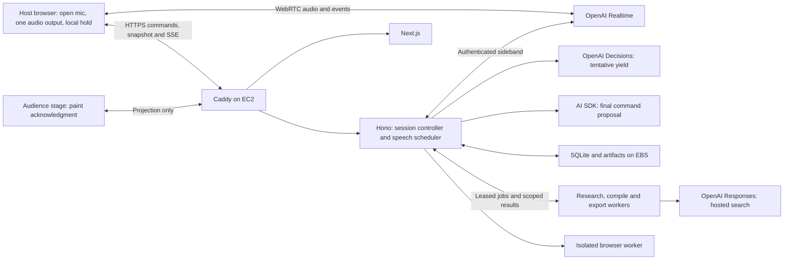

# Voice architecture for research and presentation

**MVP decision, 21 November 2026.** Use OpenAI Realtime speech-to-speech over WebRTC for both phases, standalone OpenAI Decisions for tentative yield, the Vercel AI SDK for finalized natural-language commands, and a TypeScript session controller in Hono on Bun. The public entry runs on AWS. Hands-free conversation is the intended experience in both phases. Offer keyed Talk for difficult rooms and typed controls for accessibility. One authenticated host controls one physical mic. The application session survives voice disconnects and the transition from private preparation to public delivery.

## Connections and ownership

The host establishes WebRTC through a Hono SDP broker. Keep the provider key and call association on the server. Attach the server sideband before arming speech. Configure input transcription, disable automatic response creation and automatic interruption, and let exactly one scheduler request each response. Enable browser echo cancellation, attach the remote audio output once, and keep the mic track active during narration. The browser handles a provisional hold immediately on **observed** onset. Remote VAD incurs network delay. A browser-side acoustic hint can be evaluated for faster local ducking if measurements miss the target. The AWS round trip and text classifier are outside the immediate playback-control path. [OpenAI server-side controls](https://developers.openai.com/api/docs/guides/voice-server-controls?api=realtime) · [Realtime conversation controls](https://developers.openai.com/api/docs/guides/realtime-conversations)

**Why this protocol.** Live is a strong fit for an open-ended interview alongside delegated work. Its primary WebSocket guide describes continuous output without a per-utterance audio-done event. Its sideband guidance assigns audible playback control to the client or relay. Realtime WebRTC supplies response-scoped cancellation, completion and output-buffer events useful for turn-by-turn stage control. A single protocol keeps stage and interview behavior reproducible with the same test harness. Use standalone Decisions on selected transcript partials in Realtime. Native GPT-Live transcript triggers belong to a different protocol. LiveKit merits another look if separate participant tracks become a requirement. A Python media worker merits another look if captured-room trials show local audio processing would solve a measured problem. [GPT-Live](https://developers.openai.com/api/docs/guides/live) · [Live WebSockets](https://developers.openai.com/api/docs/guides/voice-websockets) · [Realtime server events](https://developers.openai.com/api/reference/resources/realtime/server-events) · [Decisions](https://developers.openai.com/api/docs/guides/decisions) · [LiveKit adaptive interruptions](https://docs.livekit.io/agents/logic/turns/adaptive-interruption-handling/)

## One foreground conversation, independent background work

| Owner | During private research | During public presentation |
|---|---|---|
| Turn detector | Start with semantic VAD at medium eagerness so a thinking pause can stay within a thought. Ask one spoken follow-up when a consequential field is missing. | Start with server VAD on a close mic. Calibrate onset threshold, prefix padding and trailing silence using actual room recordings. A short pause within a compound request must preserve its pinned target. |
| Floor and intent | Onset holds any spoken question or status update. The host can give a correction, ask for progress, answer a clarification, or direct the next research action while search is running. | Onset holds the active beat, answer or browser commentary. A final authorized turn can pause, resume, ask, filter, skip, navigate or request clarification. |
| Speech scheduler | Speak the greeting, clarification, requested progress, significant gap and review-ready offer. Coalesce repeated progress. Queue the latest relevant update until the host finishes. Read current job state directly for a status question. | Speak only an authorized public utterance. Narration waits for the exact visible beat, tour speech for its frame, and answers for verified evidence. Silence after an answer holds position. |
| Controller and worker | Build confirms the current brief and enqueues one job. A new brief or narrower source policy supersedes dependent work. Private findings accumulate while conversation continues. | The controller privately previews a content diff, waits for the host to approve the proposal ID against its base revision, commits it once and remaps the agenda. On decline, resume the approved revision. A lookup can run in the background during Q&A. An answer changes the export only at host request. |

Keep speech detection, endpointing and action interpretation separate. For “wait … show enterprise only,” yield on onset, retain the input turn until finalization and bind “enterprise” to the target at onset. If ASR splits the phrase into two finals, a standalone “wait” leaves the cursor held and the next instruction uses that cursor. Standalone Decisions evaluates a bounded partial, recent spoken line and phase with three choices (yield, keep listening, uncertain). While a decision is in flight keep the newest subsequent partial, supersede out-of-date results by turn and sequence, and ignore results after the final. On refusal, timeout or quota exhaustion, keep the reversible hold and resolve using the final turn. Final command proposals are schema-validated against current permissions, source policy and revision. Buttons have a direct command path. [Realtime VAD](https://developers.openai.com/api/docs/guides/realtime-vad) · [OpenAI Decisions](https://developers.openai.com/api/docs/guides/decisions)

### The three paths that must remain responsive

1. **Foreground.** A new host control endpoint accepts finalized turns and explicit commands even during a job. Pin session, host lease, connection generation, turn and visible target at onset. Order final transcripts by source item and predecessor, with a bounded wait for a missing predecessor. A late transcript from an expired turn enters history only. Serialize conflicting commits by command ID and expected revision. Keep the event loop free of parsing and browser work. [Realtime transcription ordering](https://developers.openai.com/api/docs/guides/realtime-transcription)
2. **Background.** Preserve the existing model-step and mapped-tool abstractions. Introduce job uniqueness by session, kind and input revision. Each worker receives its own abort signal and lease. Reserve foreground model capacity and bound background concurrency. A status request never waits behind an SDK search loop. On “only my files,” prevent new outbound dispatches and revalidate in-flight results at commit. Rebuild derived artifacts that used excluded evidence. Previously dispatched queries cannot be retracted. Require actual hosted-search calls and citation anchors for public claims.
3. **Output.** Each speech request carries content, visibility, purpose, response ID once assigned, voice generation, target and revision. Permit one active output. Explicit stop/finish invalidates it immediately. Prioritize host answers and clarification over narration, and narration over unsolicited updates. Before speaking a queued result, recheck phase, host floor, revision and approval. Keep worker token streams private. An uncertain amount, URL or consequential name gets a spoken read-back or typed correction before execution.

### Private-to-public transition

A spoken “Present” in review and the button share one command. Pin the approved bundle, deck revision and agenda. Drain or discard private speech, revoke the old host output generation, and close its media connection. Create a fresh public voice context and remote audio track from the approved projection, language, current beat and permitted evidence. Leave the mic available for Stop or cancel during setup and visibly indicate the brief handoff. The old connection can never unmute into the room. Start only after the new session is ready, the host audio output is unlocked and the audience has painted the correct visual. If setup stalls, keep the stage paused with Retry and manual controls. A separate audience device receives visuals only. Hold private spoken coaching until a separate host audio output is explicitly selected.

### End-of-beat race

Provider completion and host speech can travel by different paths. Require all of the following for automatic slide progression:

- The audience has acknowledged the exact target, revision and render generation.
- Successful generation and normal output-buffer drain belong to the active response. A cleared or canceled response is ineligible.
- The host playback owner sends an application-level release for this response after observing normal completion and checking its local interruption flag. Sequence release and hold on the same ordered host control stream, or give HTTP commands sequence numbers and wait for missing predecessors. Attach a new lease and sequence origin on reconnect. An onset observed before release suppresses release. A genuine onset after release binds to the stage the host actually saw. Reject ambiguous stale targets and ask before applying a destructive command.
- The controller still has the same epoch, response, revision, purpose and unheld cursor. Consume the completion once. Only narration advances slide beats. A tour advances its own step. An answer or research prompt returns to listening.

A host release attests to local state, not the instant sound physically left the loudspeaker. Realtime reports server buffer drain. Device buffering, acoustic echo cancellation and human-perceived cutoff still need hardware measurement. If completion or paint is missing, hold with manual Next. If a false onset muted a meaningful part of a beat, invalidate that attempt and replay the pinned sentence with a fresh response ID. [Realtime playback events](https://developers.openai.com/api/reference/resources/realtime/server-events)

## Simulations and measured results

| Experiment | Method and observed outcome | Architectural consequence |
|---|---|---|
| Current backend concurrency | Called SessionStore.start twice against a fresh in-memory SQLite session. Research was accepted. A second foreground run returned null. | Introduce an independent turn/control path. Keep duplicate-build protection. |
| Files-only correction during public research | Exhausted 12 unique delivery orders of status, a public result and a duplicated correction. All ended with one revision change, an answered status request and no public evidence in the active set. | Check source scope at dispatch and commit. Invalidate previously accepted evidence in the active projection too. |
| Interrupt at the last beat | Exhausted 20 allowed orderings of host onset, normal generation, drain and duplicated final edit (treated as already authorized in this playback-only fixture), conditional on local onset suppressing host release. In two schedules both provider events arrived at the server before the hold. A provider-only rule advanced prematurely in those two. The release guard produced zero premature advances and one edit per schedule. | The audio-owning host participates in progression. These counts enumerate orderings and do not estimate room probabilities. |
| Duplicate completion, reconnection and privacy | 48 normal/duplicate schedules over four speech purposes, one disconnect trace and six private-result/Present/host-finished orderings passed. | Gate by purpose, connection and phase. Flush private pending speech on transition. |
| Synthetic microphone | Six 16 kHz mono mixes across all four classic WebRTC VAD aggressiveness levels. Two consecutive 20 ms speech frames activated the gate. After ambient warm-up, noise alone stayed quiet. Isolated host speech triggered at 1,040 ms for a 1,000 ms injection. Leaked narration alone at either −36 or −24 dBFS triggered at 40 ms in all four modes. Adding the host at 1,000 ms still yielded that early trigger. | Acoustic VAD alone accepts another speaker's voice. Use echo cancellation, a reversible local hold, provisional intent and an explicit host authority policy. Absolute timings describe this fixture detector only. |

Run the event model with `python3 simulations/voice/control.py`. For the acoustic experiment on macOS, create a temporary Python environment, install `webrtcvad-wheels==2.0.14`, then run `python simulations/voice/acoustic.py` there. It synthesizes two utterances with macOS voices, mixes deterministic noise and residual speech at the stated levels, warms the detector, and reports first-trigger times for modes 0–3. The synthetic residual models sound after imperfect echo suppression. No real room impulse response, browser echo canceller, OpenAI inference or network is exercised. The event model specifies a proposed controller and uses preassigned final intents. Only the concurrency probe exercised the current session store. For that probe, run `bun simulations/voice/current-store.ts` from the root.

## AWS operation and release order

1. **Controller and voice shell.** Implement foreground turns, leased host ownership, speech purposes and replayable controls first. Wire browser WebRTC, server sideband and standalone Decisions. Run hands-free question → spoken answer → barge-in in a private session. A revoked host tab loses mic and output ownership.
2. **Spoken research.** Connect the existing model service and context tools to leased research jobs, typed evidence, sources and review. Speak a brief, correct it during real search, ask for progress, narrow scope, and obtain the versioned Markdown. Correlate usage separately for voice, Decisions, text attempts and hosted tools. Alert on unknown usage and enforce separate time and concurrency budgets.
3. **Public delivery.** Use a saved, reviewed research bundle from an empty transcript. Verify private-queue purge, audience paint, handoff, narrated beats, grounded spoken Q&A and compound edits. Reconnect paused from SQLite. If the provider disconnects, keep work running, revoke old playback and restore only authorized context.
4. **Browser, export and failure rehearsal.** Tie speech to observed frames, restore the parked beat, export a pinned revision and rehearse lost input, echoed narration, two host tabs, provider timeout and an EC2 process restart. Lease recovery must replace the starter's blanket failure of unfinished runs before separate workers open the same store.
5. **Public access.** Use the EC2 Compose deployment behind Caddy with public DNS, TLS and mounted EBS. Add the worker under process supervision and issue scoped audience links. Test UI, authenticated SDP creation, sideband, SSE reconnect and a complete voice-only journey from an external network. If WebRTC media is blocked, direct the host to another network or provide typed/manual controls; Talk shares the media path and cannot repair a blocked transport. The repo has deployment configuration. This decision has no verified public endpoint yet.

**Hardware acceptance.** Run a counterbalanced set on a headset and laptop speakers with recorded onset and audible output on a common clock. Include stop/ruko/niruthu, backchannels, negation, quotation, missed or duplicated finals, compound requests and two overlapping speakers. Keep adjudicated expected actions per fixture. Record p50/p95 audible stop, incomplete utterances, false sustained holds per ten minutes, final-to-commit delay, incorrect actions, stale advances, and spoken-number agreement with the displayed metric. Use the targets in architecture.md, including 19/20 per stop phrase, proposed p95 ≤350 ms, zero unauthorized mutations in 30 negatives, and 18/20 compound commands. If hands-free misses the gate, disclose the affected setup and offer Talk while acoustic tuning continues. If generated narration changes a tested metric, hold automatic narration for that content and use approved-script audio with a local playback acknowledgment before enabling it again. No provider quality, accuracy or latency number has been measured in these simulations.
